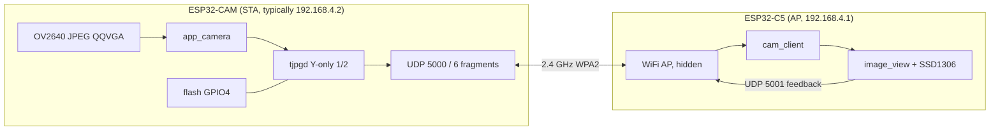

# ESP32-AirCamDuo

**Dual-board wireless viewfinder: ESP32-CAM + ESP32-C5 → SSD1306**

> **Status: planning / alpha.** The core UDP gray8 link is implemented and measured. Hardware items (viewer buttons, C5 shutter, SD capture, image preview) are unverified or planned. See [TODO.md](TODO.md).

ESP32-AirCamDuo streams a 128×64 grayscale luma frame from an ESP32-CAM to an ESP32-C5 over UDP and draws it on a 128×64 SSD1306 OLED. The camera performs the JPEG decode and panel-sized resampling; the viewer normally only reassembles and draws. A 1 Hz feedback packet lets the camera pace itself against the product target of 15–20 fps. The current control deadband is 18–20 fps so the measured result stays above the ≥18 fps acceptance line.

**Naming boundary.** `AirCamDuo` = Air (wireless) + Cam (camera) + Duo (dual board); the current transport is grayscale luma. Full-JPEG capture to SD and image preview are planned and do not change the project name.



## Features

| Feature | State | Notes |
|---|---|---|
| UDP gray8 link | **Implemented** | 128×64, 8,192 B/frame, 6 fragments, 18.5–20.5 fps measured |
| tjpgd Y-only decode on camera | **Implemented** | encode 11–12 ms |
| Viewer zero-decode default path | **Implemented** | the default `format=0` path does not decode; a compatibility fallback exists for `format=1` |
| Adaptive pacing | **Implemented** | product target 15–20 fps, deadband 18–20 fps, acceptance ≥18 fps |
| Reassembly | **Implemented** | `frame_id` + receiver-side 64-bit fragment mask; header carries `frag_index`/`frag_count` |
| Auto flash | **Implemented** | OV2640 AEC + panel-average fallback, 600/250 thresholds, 3 s dwell |
| Hidden SoftAP | **Implemented** | `ESP32-C5-CAM`; the camera joins by SSID |
| Camera HTTP side channel | **Implemented** | `/`, `/stream`, `/jpg`, `/raw`, `/mode`, `/status` |
| Photo-freeze logic | **Hardware-unverified** | short press freezes; hold ≥500 ms resumes. Viewer GPIO0 produces no events on the current board; actual BOOT pin TBD |
| C5 multi-button controls | **Planned** | decided: `KEY_FREEZE=GPIO3`, `KEY_SHUTTER=GPIO0`, `KEY_PREVIEW=GPIO1`, active low; GPIO0 is the BOOT strap |
| SD JPEG capture | **Planned** | SDMMC 1-bit (CLK14/CMD15/D0 2), `IMG_%04u.JPG`, NVS counter, `SAVED` feedback; the viewer stays on the captured frame |
| Image preview switching | **Planned** | last N (default 10) JPEGs from SD; `KEY_PREVIEW` cycles; long `KEY_FREEZE` exits |

## Hardware

| Part | Notes |
|---|---|
| ESP32-CAM (AI-Thinker) | OV2640, 4 MB flash, PSRAM; XCLK **GPIO0**; flash LED **GPIO4**; microSD slot (1-bit planned: CLK14/CMD15/D0 2) |
| ESP32-C5 dev board | 16 MB flash; SoftAP + UDP receiver + OLED driver |
| SSD1306 128×64 | I2C, 0x3C, SDA **GPIO8**, SCL **GPIO9**, 400 kHz |
| Buttons | planned: `KEY_FREEZE=GPIO3`, `KEY_SHUTTER=GPIO0`, `KEY_PREVIEW=GPIO1`, active low; current firmware has a single GPIO0 button, unverified |
| Power | USB; LiPo/TP4056 is a future option |

> The camera’s GPIO0 is the sensor XCLK and cannot be used as a user button. Use a spare camera GPIO (e.g. GPIO13) or the viewer’s buttons.

## Protocol

**Data (camera → viewer, UDP 5000)**: 16-byte header, magic `0x4341`, `frame_id`, `width`/`height` (128×64), `format` (0=gray8, 1=jpeg compat), `frag_index`, `frag_count`, `reserved`, `payload_len`; payload ≤1400 B, six fragments per frame. The receiver (not the header) tracks a 64-bit mask to drop duplicates.

**Feedback (viewer → camera, UDP 5001)**: 8 bytes, magic `0x4342`, `fps_x10`, `drops`, `reserved`.

## Measured performance

Bench measurements on the current two boards; not a guarantee.

| Metric | Value |
|---|---|
| Displayed fps | 18.5–20.5 (steady) |
| Frame | 128×64 gray8, 8,192 B, 6 UDP fragments |
| Camera: capture / encode / send | 0 / 11–12 / 11–12 ms |
| Viewer: fetch / render / flush | 21–24 / 5 / 25 ms |
| Link | 802.11n 20 MHz MCS7, RSSI −40…−50 dBm, ~1.3 Mbps at 20 fps |
| Viewer free heap | ~120 KB |
| Send errors / drops | 0 / 0 in steady state (a single transient ENOMEM has been observed) |

## Build & flash

Requirements: ESP-IDF **6.1**, two USB-serial ports.

```bash
# Camera (ESP32)
cd esp32cam && idf.py build && idf.py -p COM5 flash monitor

# Viewer (ESP32-C5)
cd esp32_oled && idf.py build && idf.py -p COM8 flash monitor
```

- After changing any `Kconfig.projbuild`, run `idf.py reconfigure`.
- If a `build/` directory was created from another path, delete it and rebuild.
- Demo credentials: change `APP_AP_SSID`/`APP_AP_PASSWORD` (viewer) and `APP_WIFI_STA_SSID`/`APP_WIFI_STA_PASSWORD` (camera) together before use.

## Configuration

| Side | Option | Default |
|---|---|---|
| Viewer | `APP_AP_SSID` / `APP_AP_PASSWORD` | `ESP32-C5-CAM` / `c5cam12345` |
| Viewer | `APP_AP_HIDDEN` | `y` |
| Viewer | `APP_AP_CHANNEL` | `6` |
| Viewer | `APP_UDP_PORT` | `5000` (feedback = +1) |
| Viewer | `APP_BUTTON_GPIO` / `APP_BUTTON_ACTIVE_LOW` | `0` / `y` (current single key, hardware unverified) |
| Viewer | `APP_BUTTON_FREEZE_GPIO` (planned) | `3` |
| Viewer | `APP_BUTTON_SHUTTER_GPIO` (planned) | `0` (BOOT strap) |
| Viewer | `APP_BUTTON_PREVIEW_GPIO` (planned) | `1` |
| Viewer | `APP_PREVIEW_COUNT` (planned) | `10` |
| Viewer | `APP_VIEW_GAIN` / `APP_VIEW_DITHER` | `110` / `y` |
| Camera | `APP_WIFI_MODE` | `STA` (joins viewer AP) |
| Camera | `APP_WIFI_STA_SSID` / `APP_WIFI_STA_PASSWORD` | `ESP32-C5-CAM` / `c5cam12345` |
| Camera | `APP_WIFI_AP_SSID` / `APP_WIFI_AP_PASSWORD` | `ESP32-CAM` / `esp32cam123` (fallback AP) |
| Camera | `APP_JPEG_SIZE` | `QQVGA` (160×120) |
| Camera | `APP_UDP_SOURCE` | `JPEG` |
| Camera | `APP_UDP_HOST` / `APP_UDP_PORT` | `192.168.4.1` / `5000` |
| Camera | `APP_UDP_ADAPT` / `APP_UDP_INTERVAL_MS` | `y` / `10` |
| Camera | `APP_FLASH_DARK_AEC` / `APP_FLASH_BRIGHT_AEC` / `APP_FLASH_DWELL_MS` | `600` / `250` / `3000` |

Planned (not in firmware yet): `APP_BUTTON_FREEZE_GPIO=3`, `APP_BUTTON_SHUTTER_GPIO=0`, `APP_BUTTON_PREVIEW_GPIO=1`, `APP_PREVIEW_COUNT=10`.

## Repository layout

```text
esp32cam/       ESP32-CAM firmware (JPEG capture, tjpgd grayscale, UDP sender, HTTP side channel)
  components/tjpgd_gray/   vendored tjpgd with a grayscale config
esp32_oled/     ESP32-C5 firmware (SoftAP, UDP reassembly, SSD1306, button)
docs/TECHNICAL_DESIGN.md  Technical design (English)
TODO.md         Current gaps and roadmap
```

## Known limitations

- UDP has no ACK/retransmission, authentication or encryption beyond WPA2.
- If viewer feedback is lost, the camera’s send interval freezes at its last value (no auto-recovery yet).
- The viewer button wiring is unverified; planned mapping is `KEY_FREEZE=GPIO3`, `KEY_SHUTTER=GPIO0`, `KEY_PREVIEW=GPIO1`. **GPIO0 is the BOOT strap**: holding it at reset enters download mode.
- Multi-button freeze/shutter/preview, SD capture and image preview are planned, not implemented.
- GPL-2.0 is selected, but the vendored `esp32-camera` and `esp_jpeg` components are Apache-2.0 (not GPLv2-compatible); review before redistribution.
- The display’s I2C full refresh (25–33 ms) caps the panel at ~30–33 fps.
- No OTA, no automated tests.

## Documentation

- Technical design (English): [`docs/TECHNICAL_DESIGN.md`](docs/TECHNICAL_DESIGN.md)
- Roadmap and acceptance criteria: [`TODO.md`](TODO.md)

## License

GPL-2.0. See [`LICENSE`](LICENSE).

> Compatibility note: the vendored `esp32-camera` and `esp_jpeg` components are Apache-2.0; Apache-2.0 is not GPLv2-compatible. Review the combined distribution (or use GPL-3.0) before publishing binaries.
