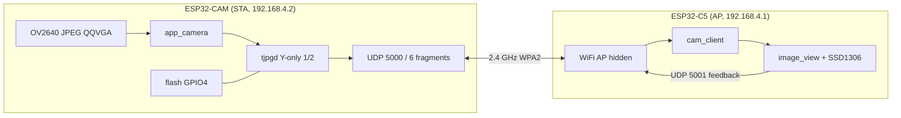

# DualLuma VF

**Dual-node wireless viewfinder: ESP32-CAM → ESP32-C5 → SSD1306**

DualLuma VF streams a 128×64 grayscale luma image from an ESP32-CAM to an ESP32-C5 over UDP and renders it on a 128×64 SSD1306 OLED. The camera does the JPEG decode and panel-sized downscale; the viewer only reassembles and draws. A 1 Hz feedback packet lets the camera pace itself inside a 15–20 fps target.



## Features

- **128×64 grayscale live preview** at **18.5–20.5 fps** measured (design target 15–20, acceptance ≥18).
- **Luma-only link**: the camera decodes JPEG with tjpgd (`JD_FORMAT=2`, 1/2 scale) and sends one 8,192-byte panel frame per update; the viewer does no JPEG decode.
- **Adaptive pacing**: the viewer reports displayed fps and dropped frames once per second; the camera adjusts its send interval in 5 ms steps.
- **Robust reassembly**: 16-byte header, `frame_id` + 64-bit fragment mask, 1,400-byte fragments, incomplete frames dropped without stalling.
- **Auto flash**: OV2640 AEC plus panel-average fallback, 600/250 thresholds and a 3 s dwell to avoid ping-pong.
- **Photo freeze**: short press on the viewer’s IO0 button freezes the current frame; hold ≥500 ms to resume video (see limitations).
- **Hidden SoftAP** by default (`ESP32-C5-CAM`); the camera joins by SSID.
- **Web UI side channel** on the camera: `/`, `/stream`, `/jpg`, `/raw`, `/mode`, `/status`.

## Hardware

| Part | Notes |
|---|---|
| ESP32-CAM (AI-Thinker) | OV2640, 4 MB flash, PSRAM; XCLK is **GPIO0**; flash LED is **GPIO4** |
| ESP32-C5 dev board | 16 MB flash; SoftAP + UDP receiver + OLED driver |
| SSD1306 128×64 | I2C, address 0x3C, SDA **GPIO8**, SCL **GPIO9**, 400 kHz |
| Button | viewer GPIO0 (BOOT/IO0), active low; actual board pin **TBD** |
| Power | USB; LiPo/TP4056 is a future option |

> The camera’s GPIO0 is the sensor XCLK and cannot be used as a user button. Use a free camera GPIO (e.g. GPIO13) or the viewer’s IO0.

## Protocol

Data (camera → viewer, UDP 5000):

```c
typedef struct __attribute__((packed)) {
    uint16_t magic;        // 0x4341
    uint16_t frame_id;     // wraps at 65535
    uint16_t width;        // 128
    uint16_t height;       // 64
    uint8_t  format;       // 0 = gray8, 1 = jpeg (compat)
    uint8_t  frag_index;
    uint8_t  frag_count;
    uint8_t  reserved;
    uint32_t payload_len;
} cam_udp_header_t;        // 16 bytes
```

Feedback (viewer → camera, UDP 5001): 8 bytes, magic `0x4342`, `fps_x10`, `drops`.

## Measured performance

| Metric | Value |
|---|---|
| Displayed fps | 18.5–20.5 (steady) |
| Frame | 128×64 gray8, 8,192 B, 6 UDP fragments |
| Camera: capture / encode / send | 0 / 11–12 / 11–12 ms |
| Viewer: fetch / render / flush | 21–24 / 5 / 25 ms |
| Link | 802.11n 20 MHz MCS7, RSSI −40…−50 dBm, ~1.3 Mbps at 20 fps |
| Viewer free heap | ~120 KB |
| Send errors / drops | 0 / 0 in steady state |

## Build & flash

Requirements: ESP-IDF **6.1**, two USB-serial ports.

```bash
# Camera (ESP32)
cd esp32cam
idf.py build
idf.py -p COM5 flash monitor

# Viewer (ESP32-C5)
cd esp32_oled
idf.py build
idf.py -p COM8 flash monitor
```

- After changing any `Kconfig.projbuild`, run `idf.py reconfigure` (new options do not appear in `sdkconfig` otherwise).
- If a `build/` directory was created from another path, delete it and rebuild.
- Default credentials are demo values; change `APP_AP_SSID`/`APP_AP_PASSWORD` (viewer) and `APP_WIFI_STA_SSID`/`APP_WIFI_STA_PASSWORD` (camera) together.

## Configuration

| Side | Option | Default |
|---|---|---|
| Viewer | `APP_AP_SSID` / `APP_AP_PASSWORD` | `ESP32-C5-CAM` / `c5cam12345` |
| Viewer | `APP_AP_HIDDEN` | `y` |
| Viewer | `APP_AP_CHANNEL` | `6` |
| Viewer | `APP_UDP_PORT` | `5000` (feedback = +1) |
| Viewer | `APP_BUTTON_GPIO` | `0` |
| Viewer | `APP_VIEW_GAIN` / `APP_VIEW_DITHER` | `110` / `y` |
| Camera | `APP_JPEG_SIZE` | `QQVGA` (160×120) |
| Camera | `APP_UDP_SOURCE` | `JPEG` |
| Camera | `APP_UDP_HOST` / `APP_UDP_PORT` | `192.168.4.1` / `5000` |
| Camera | `APP_UDP_ADAPT` / `APP_UDP_INTERVAL_MS` | `y` / `10` |
| Camera | `APP_FLASH_DARK_AEC` / `APP_FLASH_BRIGHT_AEC` / `APP_FLASH_DWELL_MS` | `600` / `250` / `3000` |

## Repository layout

```text
esp32cam/       ESP32-CAM firmware (JPEG capture, tjpgd grayscale, UDP sender, HTTP side channel)
  components/tjpgd_gray/   vendored tjpgd with a grayscale config
esp32_oled/     ESP32-C5 firmware (SoftAP, UDP reassembly, SSD1306, button)
docs/技术文档.md  Chinese technical design document (architecture, specs, tuning log)
TODO.md         Remaining work / roadmap
```

## Documentation

- Technical design (Chinese): [`docs/技术文档.md`](docs/技术文档.md)
- Roadmap and known gaps: [`TODO.md`](TODO.md)

## Known limitations

- UDP has no ACK/retransmission, authentication or encryption beyond WPA2.
- The viewer’s IO0 button has not produced events on the current board; the actual BOOT pin is **TBD**.
- No SD card storage in this repository yet (see roadmap).
- The display’s I2C full refresh (25–33 ms) caps the panel at ~30–33 fps.
- No OTA, no automated tests.

## License

No license has been chosen yet. Add one before distributing or publishing this repository.
