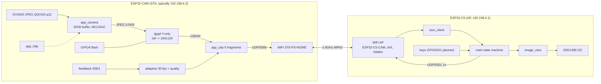
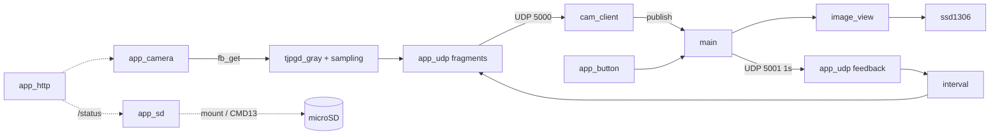
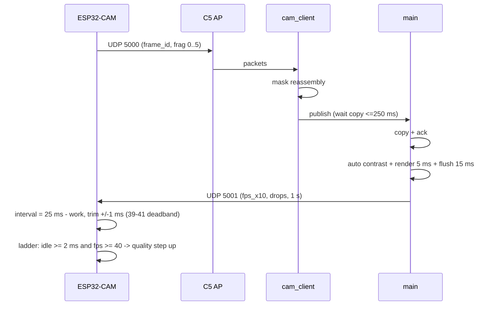

# ESP32-AirCamDuo — Technical Design

**Dual-board wireless viewfinder: ESP32-CAM + ESP32-C5 → SSD1306**

| Document information | Value |
|---|---|
| Project | ESP32-AirCamDuo (dual-board wireless camera/viewfinder) |
| Version | v1.2 |
| Date | 2026-11 |
| Status | planning / alpha — core UDP gray8 link implemented; buttons, SD capture and preview are decided and planned, not implemented |
| License | GPL-2.0 (see `LICENSE`) |
| Scope | `esp32cam/` (ESP32) and `esp32_oled/` (ESP32-C5), plus their UDP link |
| Readers | architecture reviewers, firmware engineers, test/tuning engineers |
| Conventions | **TBD-CONFIRM**: implemented or claimed, but must be checked against code/hardware. **TBD-ADD**: missing material; needs a test or a design decision. |

**Revision history**

| Version | Change |
|---|---|
| v0.1 | Initial draft (overview, architecture, modules, tuning) |
| v0.2 | Merged draft (implementation spec, experiment log, pitfalls) |
| v1.0 | Review: name, background/device boundaries, frame-rate vocabulary, interface prototypes, lifecycle, priority rationale |
| v1.1 | Second review: ESP32-AirCamDuo naming, multi-button/preview planning, decode/crop ownership, complete pseudocode, status words, license/status |
| v1.2 | English edition; button GPIOs, shutter semantics, preview source and GPL-2.0 decided |

---

# 1. Background and Technical Context

## 1.1 Motivation

**Direct motivation**: send the ESP32-CAM image wirelessly to a 128×64 OLED so the camera and the viewfinder can be physically separated, at low cost and low latency.

**Scenarios** (as understood from this project's history):

- the camera is mounted where a person cannot easily look at it (pan/tilt, pipe, enclosure), and a remote viewfinder is needed;
- the camera has no flip/viewfinder screen, or commercial wireless video is too expensive;
- teaching/prototyping: demonstrate a complete capture → encode → wireless → display chain with two common boards.

**Pain points**: cable length/orientation; cost and power of commercial links; JPEG streaming to a weak receiver causes high CPU load and low frame rate.

**Goals / non-goals**:

- Goal: product target 30 fps; measured 30.0–30.7 fps; acceptance ≥29 fps; stable (send errors=0, controlled drops, self-reconnect); auto flash; auto contrast; quality traded for idle frame time; button freeze; SD capture and preview planned.
- Non-goals (current): cloud, recording, audio, OTA, production provisioning, battery/enclosure.

> The exact product scenario (inspection / teaching / consumer) is still to be confirmed. TBD-ADD

## 1.2 Device Capability Boundaries

| Device / component | Capability | Hard limit | Architectural impact |
|---|---|---|---|
| OV2640 | hardware JPEG; QQVGA/QVGA; YUV422 | YUV422 QQVGA measured ≈**13.5 fps**; JPEG QQVGA sustains ≥20 fps | JPEG capture must be the source; raw YUV is slower |
| ESP32 (CAM) | dual-core 240 MHz, PSRAM, ROM tjpgd | **no H.264/H.265 hardware encoder** | no video codec; local JPEG→gray only |
| ESP32-C5 | 2.4/5 GHz, Wi-Fi 6, SoftAP | no video hardware decoder; ESP32 only sees 2.4 GHz | AP + UDP receive + display |
| SSD1306 | 128×64 mono, I2C 400 kHz (spec) | full refresh 1,024 B: **25–33 ms @400 kHz**, 18 ms @600 kHz, 15 ms @800 kHz (overclock, tested) | display is the wall; overclock raises the ceiling to ~45 fps |
| tjpgd R0.03 | `JD_FORMAT=2` Y-only; 1/2, 1/4, 1/8 scale | needs a vendored copy/config | CAM grayscale decode 11–12 ms |
| ESP-IDF 6.1 / lwIP | UDP sockets, esp_timer, NVS | no reliable UDP | custom fragmentation + feedback pacing |
| LiPo/TP4056 (reference) | portable power | boost/charge/ADC needed | current build is USB-powered |

**Resolution / XCLK / PSRAM envelope** (vendor data plus community measurements; this project does not overclock):

| Source size | 20 MHz XCLK (theoretical) | 40 MHz overclock |
|---|---|---|
| < HVGA (e.g. CIF 352×288) | ~50 fps | ~100 fps (community, not used) |
| HVGA–XGA (e.g. SVGA 800×600) | ~25 fps | ~50 fps, unstable |
| XGA+ (e.g. UXGA 1600×1200) | ~12.5 fps | ~25 fps theoretical; PSRAM-bound ~2–4 fps |

- OV2640 spec is 6–27 MHz; **20 MHz is the fixed default** in this project. 40 MHz needs a 1-bit LEDC duty (already the case) but is unstable at SVGA and above; it is deliberately not used.
- PSRAM bandwidth is ~20 MB/s. At UXGA a YUV422 round trip is ~7.68 MB/frame → ~2.6 fps; at QQVGA the frame is tiny, so PSRAM is not limiting.
- Grayscale: raw capture peaks around 32 fps with dual-core; RGB→gray conversion drops to ~12.5 fps. This project avoids that conversion by decoding only Y (tjpgd) and sending a panel-sized gray frame.
- Conclusion: QQVGA JPEG at 20 MHz is not sensor- or PSRAM-bound. With the display overclocked to 800 kHz (flush 15 ms → ~45 fps ceiling) the CAM pipeline becomes the limit: 0 ms capture, 17–19 ms full-size luma decode and panel resampling, 4 ms to send six fragments, 33 ms period at 30 fps. The remaining 9–14 ms are given back to picture quality.

## 1.3 Bandwidth and Latency Budget

**Frame bytes**:

- panel gray: 128×64×1 B = **8,192 B/frame**;
- UDP payload: 6 fragments (5×1400 + 1,192) + 6×16 B headers = 8,288 B;
- IP/UDP: 6×28 = 168 B → 8,456 B;
- 802.11 MAC/FCS/BA: ≈272 B → ≈8.7 KB/frame.

**Bandwidth**:

- 30 fps × 8.7 KB ≈ **2.1 Mbps**;
- negotiated 802.11n 20 MHz 1SS MCS7 = **72.2 Mbps**;
- ≈**3%** of PHY; ≈10% even at 30% MAC efficiency → **the air is not the bottleneck**, and the sensor JPEG size (3–5 KB) never reaches the wire because the camera re-encodes to a fixed 8,192 B panel frame.

**Latency** (bench means; end-to-end scheduling not separately instrumented):

| Stage | Time |
|---|---|
| CAM capture | 0 ms (GRAB_LATEST, buffer already full) |
| CAM encode (tjpgd Y-only full size + resampling) | 17–19 ms |
| CAM send (6 fragments, back to back) | 4 ms |
| CAM pacing sleep | 9–14 ms (the budget the quality ladder competes for) |
| Air (8.7 KB at 72 Mbps) | ≈1 ms |
| C5 fetch + reassembly + copy | 5 ms of work (13–14 ms wall, the rest waits for the slot) |
| C5 auto contrast + render | 5 ms |
| C5 flush | 14–15 ms @800 kHz (25 ms @400 kHz) |
| Frame period at 30 fps | **33 ms** |

→ **Encoding and the I2C flush are the bottlenecks; the air is not.** This explains the later decisions: full-size decode only costs 3 ms (E20) while the display clock costs 10 ms (E17), raw YUV is slower, RTSP has no benefit, and partial refresh saves little.

## 1.4 Alternatives

| Option | FPS on this hardware | Latency | Cost/complexity | Conclusion |
|---|---|---|---|---|
| HTTP single GET | 1.4–1.9 (measured) | high (per-frame connect/window) | low/low | debug only |
| MJPEG over TCP `/stream` | 1–3 (measured; 1.2–1.4 s stalls) | high | low/low | below 15 fps |
| Custom UDP + feedback | **30.0–30.7 (measured, 30 fps target)** | ≈35 ms (budget at 30 fps) | medium/medium | **adopted** |
| RTSP + H.264 | theoretical; no HW encoder/decoder | higher (encode+decode+jitter) | high/high | not adopted |
| RTSP + H.265 | same, heavier software decode | higher | higher | not adopted |
| BLE video | far below 1.4 Mbps | high | low/medium | not adopted |
| Color OLED/SPI panel | higher refresh possible | low | high/medium | out of scope |

> RTSP/H.264/BLE are **theoretical analysis**; not measured on this hardware. The conclusion follows from device capability boundaries.

## 1.5 Scope, Readers, Conventions

- Reviewers: chapters 3/4/9/10 for design, boundaries and risks.
- Coders: chapter 7 for an independent implementation.
- Tuners: chapter 8 to reproduce bottleneck analysis and optimization.
- Conventions at the top of this document.

---

# 2. Overview

## 2.1 Goals, Non-goals, Frame-rate Vocabulary

- **Product target**: 30 fps.
- **Control deadband**: 29–31 fps (`fps<29` trim −1 ms, `fps>31` trim +1 ms, trim clamped to ±8 ms).
- **Acceptance**: ≥29 fps.
- **Measured**: 30.0–30.7 fps (150 s window). Earlier steps: a 15–20 fps target (18.5–20.5 measured) and a 40 fps target (39.9–40.2 measured, only 3 ms of margin).

| Vocabulary | Value | Where used |
|---|---|---|
| Product target | 30 fps | requirements / README |
| Control deadband | 29–31 fps | `app_udp.c` pacing |
| Acceptance line | ≥29 fps | 7.8 |
| Measured band | 30.0–30.7 fps | bench, 150 s window |
| Quality ladder | JPEG 16/12/9/7/5/3 | `app_udp.c` auto quality |

- Stability: 150 s through 5 minutes steady state, send errors ≤1, drops ≤1% of frames, reconnect ≤3 s.
- Features: UDP video, auto flash, button freeze (single key now; multi-key planned), hidden AP, CAM HTTP side channel.
- Non-goals: cloud, recording, audio, OTA, production provisioning, battery/enclosure.

## 2.2 One-line Architecture

> **The CAM captures QQVGA JPEG, decodes only Y with tjpgd at full size (160×120), centre-crops to 2:1, area-averages down to 128×64 and sends six UDP fragments; the C5 reassembles, stretches the contrast to the panel's full range and draws 1bpp with Floyd–Steinberg dithering; the C5 sends 1 Hz feedback so the CAM paces itself to 30 fps and spends whatever frame time is left on sensor JPEG quality, while a polled SD monitor watches the card slot.**

## 2.3 Key Conclusions

| # | Conclusion | Evidence |
|---|---|---|
| 1 | Product target 30 fps; control deadband 29–31 fps; acceptance ≥29 fps; measured 30.0–30.7 fps | bench logs, `app_udp.c` |
| 2 | FPS evolution: HTTP 1.4–1.9 → TCP stream 1–3 → decoupled+full refresh 3.8–7.2 (E03/E06/E07) → UDP 12.4–12.7 → adaptive 16.4–16.9 → tjpgd gray 18.5–20.5 → I2C 800 kHz + feed-forward 39.9–40.2 → 30 fps target 30.0–30.7 fps (see 8.6) | 5-second windows |
| 3 | Steady state: send errors=0, drops=0; one transient ENOMEM observed | CAM/C5 logs |
| 4 | Root cause of "busy scene disconnects": JPEG buffer only 160×120/5 = 3,840 B; fixed to 32 KB | `app_camera.c`, `cam_hal.c` |
| 5 | tjpgd Y-only cut encode from 24 ms to 11–12 ms; the I2C refresh is the next wall (25 ms @400 kHz; 15 ms @800 kHz overclock → ~45 fps ceiling) | `tjpgd_gray/`, bench |
| 6 | Auto flash uses AEC plus panel average, 600/250, 3 s dwell; measured on at avg 19, off at aec 168/avg 121 | 5-minute CAM log |
| 7 | AP is hidden by default; the camera joins by SSID | Kconfig, scan |
| 8 | Open: viewer button GPIO (GPIO0 produces no events), camera GPIO0 is XCLK | logs, pin table |

---

# 3. Architecture

## 3.1 Logical Layers

| Layer | Node | Components | Responsibility |
|---|---|---|---|
| Device | CAM | OV2640 (QQVGA JPEG, q12 → q5 adaptive, XCLK 20 MHz, PSRAM), GPIO4 flash | imaging / light |
| Device | C5 | SSD1306 128×64 (I2C 0x3C, 400 kHz, SDA 8/SCL 9), GPIO keys | display / input |
| Driver | both | `esp32-camera`, `esp_driver_i2c/gpio`, `esp_wifi/netif/event`, `esp_timer`, lwIP | hardware / stack |
| Service | CAM | `app_camera`, `tjpgd_gray`, `app_udp`, `app_http`, `app_wifi`, `cam_selftest` | capture, gray encode, UDP, flash, side channel, join |
| Service | C5 | `app_wifi_ap`, `cam_client`, `image_view`, `ssd1306`, `font5x7`, `app_button` | AP, reassembly, render, display, keys |
| App | both | `main.c` | boot, display state machine, statistics |

## 3.2 Deployment



| Item | Current |
|---|---|
| AP | `ESP32-C5-CAM`, password `c5cam12345`, channel 6 (1–13), 2.4 GHz, hidden by default |
| CAM address | DHCP first lease, typically `192.168.4.2` |
| Ports | data UDP 5000; feedback UDP 5001 (= data+1) |
| Side channel | CAM HTTP: `/`, `/stream`, `/jpg`, `/raw`, `/mode`, `/status` |
| Firmware | C5 16 MB / 3 MB factory, app ~1.06 MB; CAM 4 MB / 3 MB factory, app ~0.87 MB (`idf.py size`) |
| Toolchain | ESP-IDF 6.1; C5 COM8, CAM COM5 |

## 3.3 Data Model

**Data frame (CAM→C5)**

| Field | Size | Notes |
|---|---|---|
| magic | 2 B | `0x4341` |
| frame_id | 2 B | +1 per frame, wraps at 65535 |
| width/height | 2 B×2 | 128×64 |
| format | 1 B | 0=gray8 (current), 1=jpeg (compat) |
| frag_index/count | 1 B×2 | 0-based, ≤64 |
| reserved | 1 B | planned: bit0 SAVED, bit1 PREVIEW; currently unused (TBD-CONFIRM) |
| payload_len | 4 B | bytes in this fragment |
| payload | ≤1400 B | gray data |

**Feedback (C5→CAM)**: 8 B, magic `0x4342`, `fps_x10`, `drops`, `reserved` (planned command byte: 1=shutter, 2=preview next, 3=preview exit).

**Storage**: no database; NVS for Wi-Fi calibration and (planned) the photo counter. Frames live in RAM/PSRAM.

## 3.4 Stack and Selection

| Component | Choice | Reason |
|---|---|---|
| SoC | ESP32 / ESP32-C5 | off-the-shelf; C5 can run a 2.4 GHz AP |
| Camera | OV2640 + `esp32-camera` | hardware JPEG, mature driver |
| Decode | CAM `tjpgd_gray` (Y-only); C5 `esp_jpeg` fallback only | Y-only: encode 22–24 → **11–12 ms** (E13) |
| Transport | custom UDP | no handshake/retransmit, low latency; feedback pacing |
| Display | SSD1306 + custom driver | 128×64, I2C, pins verified |
| Config | Kconfig on both sides | compile-time, reviewable |

## 3.5 Boundaries and Dependencies

- Depends on: 2.4 GHz air, OV2640/lens, SSD1306/I2C, USB power.
- Does not depend on: internet, time sync, DNS, cloud.
- Constraints: CAM only 2.4 GHz; AP must be 2.4 GHz; CAM GPIO0 is XCLK.

---

# 4. Framework Design

## 4.1 Principles

1. Encode at the edge: CAM performs JPEG decode, grayscale, crop and resample; C5 decodes nothing on the default path.
2. One-way data + reverse control: image CAM→C5; only 8 B feedback returns.
3. No server: power-on and go.
4. Self-healing: CAM STA reconnect timer 1 s; C5 receive/display tasks recover.
5. Configuration as code: everything via Kconfig.
6. Observability: 5-second summaries on both sides.

## 4.2 Layering and Dependencies

```
Application main.c
   ↓
Service (app_camera/app_udp/app_wifi/app_http | app_wifi_ap/cam_client/image_view/app_button)
   ↓
Driver (esp32-camera/i2c_master/gpio/lwip/esp_wifi)
```

- Services cooperate only through explicit interfaces; the C5 display only calls `cam_client_wait_frame()`; no cross-layer access.
- Interface contracts are in chapter 7.

## 4.3 Patterns

| Pattern | Location | Purpose |
|---|---|---|
| Producer-consumer mailbox | C5 `cam_client.c` | publish latest frame; display copies then acknowledges |
| Borrow/ack | C5 `cam_client.c` | reuse buffers; overwrite only after copy; wait ≤250 ms |
| Compile-time policy | Kconfig | size/source/ports/interval/keys/brightness/flash |
| State machines | CAM camera; C5 display | JPEG↔RAW; BOOT/WAIT/VIDEO/FROZEN/PREVIEW/LOST |
| Feedback control | `app_udp.c` + `cam_client.c` | 1 s feed-forward interval plus ±1 ms/s trim, 29–31 fps deadband |
| Probe with backoff | `app_udp.c` auto quality | step up while idle ≥2 ms, revert and double the dwell on a failed probe |
| Packed wire structs | both | little-endian protocol |

## 4.4 Cross-cutting Concerns

| Concern | Current |
|---|---|
| Logging | CAM 5 s: frames/fps/errors/interval/capture/encode/send/jpeg/flash/aec/gain/avg/rssi; C5 5 s: fps/fetch/render/flush/timeouts/errors/rssi/heap |
| Monitoring | serial only; no external metrics |
| Configuration | Kconfig; `reconfigure` required after changes |
| Auth | WPA2 link only; UDP payload has no auth/encryption |
| Errors | `esp_err_t`; socket retry/count; display failure count; decode failure drops a frame |
| Rate limiting | CAM send interval 0–120 ms, adaptive |
| Rollback | reflash; no A/B partition (TBD-ADD) |
| Watchdog | not explicitly configured (TBD-ADD) |

## 4.5 Extension Points

- CAM: `APP_JPEG_SIZE`, `APP_UDP_SOURCE`, `APP_UDP_*`, `APP_FLASH_*`, `APP_WIFI_*`.
- C5: `APP_AP_*`, `APP_UDP_PORT`, `APP_BUTTON_*`, `APP_VIEW_*`.
- No runtime plugins.

## 4.6 Communication, Data Access, Tests

- Communication: UDP 5000/5001; CAM HTTP side channel.
- Data access: no database; NVS for Wi-Fi.
- Tests: no automated tests; serial logs, manual observation, temporary ASCII preview (removed). TBD-ADD: CI.

## 4.7 Pros and Cons

| Pros | Risks |
|---|---|
| Low latency, zero decode on C5, stable 30 fps | UDP has no ACK; one lost fragment loses a frame |
| Adaptive pacing avoids backlog | feedback loss only removes the trim; the feed-forward term keeps holding the rate |
| Idle frame time buys quality instead of sleeping | the quality ladder must be debounced, or it hunts |
| Centralized, reviewable config | no auth/OTA; fixed IP/ports |
| Encoding at the edge reduces receiver load | CAM CPU/flash/sensor coupling |

---

# 5. Modules

## 5.1 CAM

### 5.1.1 `app_camera`

- **Responsibility**: OV2640 init/mode switch; JPEG/RAW config; frame get/return; enable AEC/AGC/AWB gain; self-test.
- **Interfaces**: `app_cam_init()`, `app_cam_fb_get()/return()`, `app_cam_set_mode()`, `app_cam_luma_from_fb()`, `app_cam_frame_width/height/format()`.
- **Data**: JPEG QQVGA starting at q12 and raised by the quality ladder to q5, `jpeg_buffer_size=32 KB`, `fb_count=3`, PSRAM; RAW YUV422 QQVGA, `fb_count=2`. **XCLK fixed at 20 MHz**; overclocking is not used.
- **Concurrency/errors**: mode switch lock + stream-user count; init retry twice then mark unavailable.
- **Trade-off**: 32 KB buffer avoids truncation in busy scenes; RAW is side-channel only.

### 5.1.2 `tjpgd_gray` component

- **Responsibility**: decode only the JPEG Y component, output 8-bit gray, support 1/2, 1/4, 1/8.
- **Interface**: `tjpgd_gray_decode()` (full prototype in 7.2).
- **Config**: `JD_SZBUF=512`, `JD_FORMAT=2`, `JD_USE_SCALE=1`, `JD_TBLCLIP=1`, `JD_FASTDECODE=1`, `JD_DEFAULT_HUFFMAN=0`; symbols renamed to avoid ROM conflicts.
- **Resources**: static 4,096 B work buffer; QQVGA full → 160×120 (the default), 1/2 → 80×60.
- **Trade-off**: vendored tjpgd source; keep its license notice.

### 5.1.3 `app_udp`

- **Responsibility**: frame → tjpgd gray → 128×64 sampling → six UDP fragments; feed-forward pacing, sensor quality ladder; auto flash; (planned) shutter/preview commands.
- **Implementation**: `SO_SNDBUF=16 KB`, fragments back to back (the 1 ms gap measured 12 ms of send time and 38.7 fps with no drop benefit), 3 retries with a 2 ms backoff. Pacing is feed-forward: every 5 s window `interval = 1000/target − (capture + encode + send)`, then the 1 Hz feedback trims it by ±1 ms per second within ±8 ms; clamp 0–120 ms. Quality ladder: steps 16/12/9/7/5/3, step up when `s_ff_ms ≥ 2` and fps is inside the deadband, revert and double the 8 s dwell (max 120 s) if a probe lands below target − 1, and step down after two consecutive seconds below target − 3. The ladder ignores the first 12 s after boot, because the start-up ramp looks like a slow link.
- **Logging**: 5 s summary (see 4.4).
- **Trade-off**: Y-only gray is slightly soft; scale=0 trades speed for sharpness.

### 5.1.4 `app_sd`

- **Responsibility**: watch the microSD slot; nothing else touches the card yet.
- **Why polling**: the AI-Thinker board does not route the card-detect switch to a GPIO, so presence is inferred from the bus.
- **Insert**: a task mounts `esp_vfs_fat_sdmmc_mount("/sdcard", …)` 6 s after boot, retries every 2 s while nothing answers, and logs one line per transition (`card in: 30424 MB …`).
- **Remove**: every 1 s `sdmmc_get_status()` (CMD13, no filesystem traffic); two failures in a row unmount and publish `card out (bus timeout)`. Nothing is written, so a pull cannot corrupt anything.
- **Pins**: 1-bit SDMMC, CLK 14 / CMD 15 / D0 2, 20 MHz. D1 shares GPIO4 with the flash LED, which is why the bus is 1-bit.
- **Interfaces**: `app_sd_start()`, `app_sd_get(app_sd_state_t*)`; the state also appears in `/status` as `sd: {present, mounts, mb, free_mb}`.
- **Log noise**: the sdmmc/fatfs drivers log an error per failed attempt, so `sdmmc_req`, `vfs_fat_sdmmc` and `SD_HOST` are muted; `APP_SD_LOG_DEBUG` restores them for bring-up.
- **Trade-off**: polling costs one CMD13 per second instead of a free interrupt, and a removal is noticed up to 2 s late.

### 5.1.5 `app_wifi`

- **Responsibility**: join the C5 AP; `WIFI_PS_NONE`; reconnect timer 1 s; after 20 s without IP enter APSTA fallback.
- **Interfaces**: `app_wifi_start()`, `app_wifi_url()`.
- **Trade-off**: infinite retry gives up standalone operation but recovers after a C5 reset.

### 5.1.6 `app_http` (side channel)

- Endpoints: `/`, `/stream`, `/jpg`, `/raw`, `/mode`, `/status`.
- Shares the camera with UDP; mode switch returns 409 while a stream is active.

### 5.1.7 `main` / `cam_selftest`

- Boot: board info, reset reason, NVS, camera, Wi-Fi, HTTP, UDP; sensor self-test when missing.

## 5.2 C5

### 5.2.1 `app_wifi_ap`

- **Responsibility**: SoftAP (2.4 GHz, channel 6, WPA2, max 4, hidden by default), station count/RSSI.
- **Interfaces**: `app_wifi_ap_start()`, `app_wifi_ap_ip()`, `app_wifi_ap_sta_count()`, `app_wifi_ap_sta_rssi()`.
- **Known**: `set_bandwidths(WIFI_BW20)` takes effect initially; a re-association once showed 40D (TBD-CONFIRM).

### 5.2.2 `cam_client`

- **Responsibility**: bind UDP 5000; reassemble with `frame_id` + 64-bit mask; JPEG fallback; publish latest frame; 1 Hz feedback; (planned) send commands.
- **Interfaces**: `cam_client_start()`, `cam_client_wait_frame()`.
- **Data**: 24 KB reassembly, 2 KB receive, `SO_RCVBUF=32 KB`; mailbox = mutex + two binary semaphores.
- **Errors**: incomplete frame dropped when a new frag 0 arrives; malformed packets counted; display may miss 250 ms; JPEG failure drops the frame.
- **Trade-off**: no ACK; feedback pacing; mask deduplication.

### 5.2.3 `image_view`

- **Responsibility**: gray → 1bpp; auto contrast, FS dithering. **Default input is fixed 128×64, 1:1; no crop/scale** — the 2:1 crop and the area-average/bilinear resample happen on the CAM. For compat `format=1`, the JPEG fallback produces gray first.
- **Interface**: `image_view_render(disp, gray, w, h)` (identity crop for 128×64); `image_view_agc_state(&lo, &hi, &gain_x10)` for logs.
- **Auto contrast**: one 256-bin histogram per frame (8,192 increments, well under 1 ms), 2% / 98% percentiles become 6 / 249, the window follows the measurement a quarter of the way per frame, and the stretch is capped at 3.0× so a flat night scene does not become amplified noise. `APP_VIEW_GAIN` applies only when `APP_VIEW_AGC=n`.
- **Config**: `APP_VIEW_AGC=y`, `APP_VIEW_GAIN=110` (manual mode), `APP_VIEW_DITHER=y`.
- **Trade-off**: C5 does display-side work only; generic crop code exists for non-128×64 compat input.

### 5.2.4 `ssd1306` / `font5x7`

- **Responsibility**: I2C init, framebuffer, pixel/rect/text, full refresh.
- **Interfaces**: `ssd1306_init/flush/clear/pixel/fill_rect/text`.
- **Metric**: full 1,024 B at 400 kHz measured 25–33 ms.
- **Trade-off**: full refresh is the default and self-healing. `ssd1306_flush_changed()` is available behind `APP_VIEW_PARTIAL` (default n): at max pacing it measured **29.5 fps vs 32.2 fps** for full refresh because dithering changes almost every page; a full refresh every N frames and after any I2C error keeps it safe. The I2C clock is configurable (`APP_I2C_CLOCK_KHZ`, default 400): 600/800 kHz were tested on this module with 0 errors (800 kHz: flush 15 ms, 45.1 fps max); above 400 kHz is an overclock and out of spec.

### 5.2.5 `main`

- **Responsibility**: NVS, OLED probe (SDA/SCL swap fallback), AP, boot/wait/lost screens, display loop, key handling, 5 s statistics.
- **Interaction (current)**: single key short press freezes; hold ≥500 ms resumes; `photo_mode` does not consume frames.
- **State**: `have_frame`, `lost_shown`, `photo_mode`, `consecutive_timeouts`.

### 5.2.6 `app_button`

- **Current**: GPIO0 input (pull-up, active low, 30 ms debounce, 10 ms poll); short (<500 ms) and long (≥500 ms, fires while held).
- **Interfaces**: `app_button_start()`, `app_button_take_short()`, `app_button_take_long()`.
- **Config (current)**: `APP_BUTTON_GPIO=0`, `APP_BUTTON_ACTIVE_LOW=y`.
- **Status**: task starts, but no events in 5 minutes; actual BOOT pin TBD-CONFIRM.

**Decided multi-key plan (v1.x, not implemented)**

| Key | GPIO | Semantics | Status |
|---|---|---|---|
| `KEY_FREEZE` | **GPIO3** | short press freeze/resume; long ≥500 ms force back to video | decided, not implemented |
| `KEY_SHUTTER` | **GPIO0** | short press: capture the current frame and save full JPEG to SD; stay on the current frame; show SAVED | decided, not implemented |
| `KEY_PREVIEW` | **GPIO1** | preview the last N JPEGs from SD; press again to cycle; long `KEY_FREEZE` exits | decided, not implemented |

- Active low, internal pull-up, 30 ms debounce.
- **GPIO0 is the BOOT strapping pin**: holding it during reset enters download mode. Wire carefully; a different pin is safer if the hardware allows.
- Planned interface: `bool app_button_take(app_button_key_t key, app_button_event_t event)`; Kconfig `APP_BUTTON_FREEZE_GPIO=3`, `APP_BUTTON_SHUTTER_GPIO=0`, `APP_BUTTON_PREVIEW_GPIO=1`.
- Migration note: current firmware uses a single key on GPIO0 for freeze; under the new plan GPIO0 becomes shutter, so the freeze key must move to GPIO3.

---

# 6. Function Groups

| Domain | Module | Core function | Input | Output | Dependencies | Key interface | Notes |
|---|---|---|---|---|---|---|---|
| Capture/encode | `app_camera` | sensor, modes, AEC/AGC, 32 KB buffer | light | JPEG | esp32-camera/PSRAM | `app_cam_fb_get()` | QQVGA, q12 → q5 |
| Capture/encode | `tjpgd_gray` | JPEG→Y gray, full size | JPEG | 160×120 | tjpgd | `tjpgd_gray_decode()` | Y only |
| Capture/encode | `app_udp` (encode) | resample→128×64 | 160×120 | 8,192 B | — | internal sampling | 2:1 crop, area average |
| Transport | `app_udp` (send) | 6 fragments, retry | panel frame | UDP/5000 | lwIP | `sendto()` | back to back |
| Control | `app_udp` (feedback) | fps/drops→interval, quality | feedback | interval, step | lwIP | UDP/5001 | 29–31 deadband |
| Flash | `app_udp` (flash) | AEC+avg hysteresis/dwell | brightness | GPIO4 | GPIO | — | 600/250/3 s |
| Network | `app_wifi` (CAM) | STA/reconnect/APSTA | config | network | esp_wifi | `app_wifi_start()` | PS=NONE |
| Network | `app_wifi_ap` (C5) | SoftAP/stations | config | AP | esp_wifi | `app_wifi_ap_start()` | hidden |
| Display | `cam_client` | reassembly/mailbox/feedback/JPEG fallback | UDP | `cam_frame_t` | lwIP/esp_jpeg | `cam_client_wait_frame()` | 24 KB |
| Display | `image_view` | auto contrast + FS dither | gray | 1bpp | ssd1306 | `image_view_render()` | 1:1, AGC |
| Display | `ssd1306`/`font5x7` | refresh/text | framebuffer | I2C | i2c_master | `ssd1306_flush()` | 25–33 ms |
| Input | `app_button` (C5) | freeze/shutter/preview (planned) | GPIO3/0/1 | events | GPIO | `app_button_take_*` | single key now |
| Diagnostics | `main` (both) | boot/status/statistics | config/frames | logs/screen | above | — | 5 s |
| Side channel | `app_http` | web/snapshot/mode | HTTP | HTML/image | esp_http_server | `/status` | shares camera |
| Self-test | `cam_selftest` | sensor diagnostics | — | logs | esp32-camera | — | on failure |

---

# 7. Implementation Specification

## 7.1 Protocol and Structures

### 7.1.1 Data frame (UDP 5000)

```c
typedef struct __attribute__((packed)) {
    uint16_t magic;        // 0x4341
    uint16_t frame_id;     // +1, wraps at 65535
    uint16_t width;        // 128
    uint16_t height;       // 64
    uint8_t  format;       // 0=gray8, 1=jpeg
    uint8_t  frag_index;   // 0..frag_count-1
    uint8_t  frag_count;   // 1..64
    uint8_t  reserved;     // planned: bit0 SAVED, bit1 PREVIEW
    uint32_t payload_len;  // bytes in this fragment
} cam_udp_header_t;        // 16 B
```

- Little-endian; payload ≤1,400 B; 8,192 B per frame → 6 fragments; max frame 24 KB.
- `frame_id` wrap: reset on frag 0 or a changed id; no ordering comparison.
- Dedup: 64-bit mask, one bit per fragment.
- `reserved` is currently unused (TBD-CONFIRM).

### 7.1.2 Feedback (UDP 5001)

```c
typedef struct __attribute__((packed)) {
    uint16_t magic;     // 0x4342
    uint16_t fps_x10;   // displayed fps * 10
    uint16_t drops;     // incomplete frames in this window
    uint8_t  command;   // planned: 1=shutter, 2=preview next, 3=preview exit
    uint8_t  reserved;
} cam_feedback_t;       // 8 B (current layout: reserved is uint16)
```

> Current code uses `uint16_t reserved`; the planned command byte can occupy its low byte without changing the size.

### 7.1.3 Frame view (C5)

```c
typedef struct {
    const uint8_t *data;   // 8-bit gray
    size_t len;
    uint16_t width;
    uint16_t height;
    bool from_jpeg;        // true only when the local JPEG fallback decoded it
} cam_frame_t;
```

`data` points to `cam_client`'s buffer or the caller's `dst`; valid until the next `wait_frame`.

## 7.2 Interface Contracts

| Interface | Full prototype | Context | Thread safety | Blocking | Ownership | Errors |
|---|---|---|---|---|---|---|
| `tjpgd_gray_decode` | `esp_err_t tjpgd_gray_decode(const uint8_t *jpeg, size_t len, uint8_t *out, size_t out_cap, int scale, int *width, int *height)` | CAM UDP task | no (static pool) | no | output is caller's | `ESP_ERR_INVALID_ARG/INVALID_SIZE/FAIL` |
| `app_udp_start` | `esp_err_t app_udp_start(void)` | CAM main | once | no | creates tasks | `ESP_ERR_NO_MEM` |
| `app_cam_fb_get` | `camera_fb_t *app_cam_fb_get(void)` | CAM UDP/HTTP | driver-synced | may wait | caller returns it | NULL |
| `cam_client_start` | `esp_err_t cam_client_start(void)` | C5 main | once | no | creates tasks/buffers | `ESP_ERR_NO_MEM` |
| `cam_client_wait_frame` | `esp_err_t cam_client_wait_frame(cam_frame_t *frame, uint8_t *dst, size_t dst_cap, uint32_t timeout_ms)` | C5 display | yes | `timeout_ms` | copies into `dst` | `ESP_ERR_TIMEOUT/INVALID_SIZE/INVALID_STATE` |
| `app_button_take_short` | `bool app_button_take_short(void)` | C5 main | yes (volatile) | no | consumes event | — |
| `app_button_take_long` | `bool app_button_take_long(void)` | C5 main | yes | no | consumes event | — |
| `image_view_agc_state` | `bool image_view_agc_state(int *lo, int *hi, int *gain_x10)` | C5 main (logging) | reads render-owned statics | no | copies out | false while the mapping is still identity |
| `app_sd_start` | `esp_err_t app_sd_start(void)` | CAM main | once | no | creates one task | `ESP_ERR_NO_MEM` |
| `app_sd_get` | `void app_sd_get(app_sd_state_t *out)` | CAM HTTP handler | yes (mutex, 50 ms) | no | copies out | — |
| `app_button_take` (Planned) | `bool app_button_take(app_button_key_t key, app_button_event_t event)` | C5 main | yes | no | consumes event | — |
| `ssd1306_flush` | `esp_err_t ssd1306_flush(ssd1306_t *dev)` | C5 display | no | I2C 200 ms/op | — | I2C errors |
| `app_wifi_ap_sta_rssi` | `int app_wifi_ap_sta_rssi(void)` | C5 main | yes | no | — | −127 = none |

## 7.3 Concurrency

| Node | Task | Priority | Stack | Core | Trigger | Blocks on |
|---|---|---|---|---|---|---|
| CAM | main | 1 | 6,144 | 0 (default) | boot | exits |
| CAM | `cam_udp` | 5 | 6,144 | **1 (pinned)** | boot | `fb_get`/`sendto`/delay |
| CAM | `cam_fb` (feedback) | 4 | 3,072 | **0 (pinned)** | boot | `recvfrom` |
| CAM | `mjpeg` (HTTP) | 5 | 4,096 | unpinned | browser | `send`/`fb_get` |
| CAM | `app_sd` | 2 | 4,096 | unpinned | `app_sd_start` (+6 s) | mount / CMD13 / delay |
| C5 | main | 1 | 8,192 | 0 (single-core) | boot | `wait_frame`/I2C |
| C5 | `cam_udp` | 6 | 8,192 | 0 (single-core) | `cam_client_start` | `recvfrom`/`publish` |
| C5 | `button` | 4 | 3,072 | 0 (single-core) | `app_button_start` | 10 ms delay |

Encode/send (`cam_udp`) is pinned to core 1 so the JPEG decode and UDP bursts do not compete with Wi-Fi, lwIP and the HTTP server on core 0; measured 20.2–20.4 fps after pinning, with no regression.

The SD monitor runs at priority 2, below the video tasks, and waits 6 s before its first mount: mounting during the boot ramp competed for pbufs (116 sendto ENOMEM retries and 45 dropped frames in the first 10 s), and after the delay the same boot costs 3 retries and 7 drops.

**Priority rationale**:

- CAM `cam_udp` (5) > `cam_fb` (4): image is data plane, feedback is control plane; 1 s feedback latency is acceptable; sending must not be blocked.
- C5 `cam_udp` (6) > main (1): the receiver must drain the socket to avoid UDP loss; display can run slowly in the main task.
- Button (4) > main (1): 10 ms polling must preempt the display loop.

Synchronization and lock order:

| Object | Type | Rule |
|---|---|---|
| `s_frame_ready` | binary semaphore | give after publish; display takes with 500 ms |
| `s_frame_taken` | binary semaphore | give after copy; receiver waits ≤250 ms |
| `s_pub_lock` | mutex | protects `s_pub/s_pub_valid`; no blocking/other locks inside |
| `s_short/s_long` | volatile bool | single writer (button) / single reader (main) |
| `s_ff_ms` / `s_trim_ms` | volatile int | one writer each (sender window / feedback) / read by both |
| `s_quality_*` | plain statics | feedback task only |

## 7.4 Algorithms

### 7.4.1 JPEG gray (CAM)

```c
// JD_FORMAT=2, JD_USE_SCALE=1, pool=4096
jd_prepare(&jd, in_cb, pool, sizeof(pool), &ctx);
out_w = jd.width >> scale;   // scale=1 -> 80
out_h = jd.height >> scale;  //            60
jd_decomp(&jd, out_cb, scale);
// out_cb: row-wise memcpy; row width = rect->right - rect->left + 1
```

### 7.4.2 Panel sampling (128×64)

```c
// 2:1 centre crop (same expressions as before)
// then one of two kernels, chosen by whether the panel is shrinking the source
if (crop_w >= 128 && crop_h >= 64) {
    for (y = 0; y < 64; y++) {
        sy0 = y0 + (y * crop_h) / 64;
        sy1 = max(sy0 + 1, y0 + ((y + 1) * crop_h) / 64);
        for (x = 0; x < 128; x++) {
            sx0 = x0 + (x * crop_w) / 128;
            sx1 = max(sx0 + 1, x0 + ((x + 1) * crop_w) / 128);
            sum = 0; n = 0;
            for (sy = sy0; sy < sy1; sy++)
                for (sx = sx0; sx < sx1; sx++) { sum += src[sy][sx]; n++; }
            panel[y * 128 + x] = sum / n;            /* area average */
        }
    }
} else {
    step_x = (crop_w << 16) / 128;                   /* 16.16 source coords */
    step_y = (crop_h << 16) / 64;
    for (y = 0; y < 64; y++) {
        fy = y0 * 65536 + y * step_y + step_y / 2;   /* sample at centres */
        sy = fy >> 16; wy = (fy >> 8) & 0xFF;
        for (x = 0; x < 128; x++) {
            fx = x0 * 65536 + x * step_x + step_x / 2;
            sx = min(fx >> 16, w - 1); wx = (fx >> 8) & 0xFF;
            panel[y * 128 + x] = (top * (256 - wy) + bot * wy) >> 16;   /* bilinear */
        }
    }
}
```

For the current 160×120 input: `crop_w=160`, `crop_h=80`, `y0=20` — center-crop 160×80 and area-average 1.25× down to 128×64.
With `APP_UDP_GRAY_SCALE=1` the input is 80×60, the crop is 80×40, and the same call takes the bilinear branch (1.6× enlargement) instead of showing 1–2 pixel blocks.

### 7.4.3 Brightness and dithering (C5)

```c
/* once per frame: histogram -> 2%/98% percentiles -> lut[256] */
hist[gray[i]]++ for all pixels;
lo = first value where cumsum >= 2% ; hi = first value where cumsum >= 98%;
if (hi - lo < 24) keep the previous window;                /* flat scene */
lo_ema += (lo - lo_ema) / 4; hi_ema += (hi - hi_ema) / 4;  /* no pumping */
if (hi_ema - lo_ema < 81) widen symmetrically;             /* gain <= 3.0x */
for (v = 0..255) lut[v] = clamp(6 + (v - lo_ema) * 243 / (hi_ema - lo_ema));

/* per pixel */
v = lut[gray_sampled];
v += err_row[x] / 16;
on = v >= 128;
e = v - (on ? 255 : 0);
err_row[x+1] += e*7/16; err_next[x-1] += e*3/16;
err_next[x] += e*5/16;  err_next[x+1] += e*1/16;
```

The AGC replaces the fixed `grey * 110%`: a dim scene whose 2%–98% window is 10–126 is stretched 2.1× instead of being drawn as one dark band, and a bright scene at 19–251 is left alone (1.0×).

### 7.4.4 Auto flash (CAM)

```c
avg = sum(panel) / 8192;
if (frames % 10 == 0) { sensor->init_status(sensor); aec = status.aec_value; gain = status.agc_gain; }
dark   = (aec > 600) || (avg < 20);
bright = (aec < 250) && (avg > 60);
if (!flash_on && dark   && now - changed > 3 s) flash_on = true,  GPIO4 = 1;
if ( flash_on && bright && now - changed > 3 s) flash_on = false, GPIO4 = 0;
```

### 7.4.5 Planned SD capture (not implemented)

```c
// KEY_SHUTTER: on the next camera frame
copy fb->buf (JPEG) into a PSRAM buffer; return fb;
queue {buf,len} to photo_task (depth 1);
// photo_task: fwrite IMG_%04u.JPG; fclose; then increment the NVS counter; report SAVED
```

The viewer stays on the captured frame; `KEY_FREEZE` returns to live video.

## 7.5 State Machines

### 7.5.1 Reassembly (C5)

| State | Event | Condition | Action | Next |
|---|---|---|---|---|
| IDLE | frag 0 | magic valid | reset mask/length/id | ACTIVE |
| ACTIVE | frag i | not received | copy + set bit | ACTIVE |
| ACTIVE | new id/frag 0 | incomplete | drops++, reset | ACTIVE |
| ACTIVE | complete | received == count | publish | IDLE |
| IDLE | malformed | — | drops++ | IDLE |

### 7.5.2 Display (C5)

| State | Event | Condition | Action | Next |
|---|---|---|---|---|
| BOOT | boot done | AP ready | boot screen | WAIT |
| WAIT | first frame | wait ok | render | VIDEO |
| VIDEO | `KEY_FREEZE` short | — | freeze | FROZEN |
| VIDEO | 3 consecutive timeouts | — | LOST screen | LOST |
| FROZEN | `KEY_FREEZE` long ≥500 ms | — | resume | VIDEO |
| LOST | frame recovery | wait ok | render | VIDEO |
| VIDEO/FROZEN | `KEY_SHUTTER` (planned) | SD available | save current JPEG; stay; show SAVED | unchanged |
| VIDEO/FROZEN | `KEY_PREVIEW` (planned) | photos exist | show latest | PREVIEW |
| PREVIEW | `KEY_PREVIEW` (planned) | — | next photo / back to VIDEO | PREVIEW/VIDEO |
| PREVIEW | `KEY_FREEZE` long (planned) | ≥500 ms | force VIDEO | VIDEO |

> `PREVIEW/REVIEW`, `KEY_SHUTTER`, `KEY_PREVIEW` are planned; current firmware has only single-key freeze/resume.

### 7.5.3 Camera mode (CAM)

| State | Event | Condition | Action | Next |
|---|---|---|---|---|
| JPEG | set RAW | no stream users | deinit/init YUV422 | RAW |
| RAW | set JPEG | no stream users | deinit/init JPEG | JPEG |
| any | same mode | — | `ESP_ERR_NOT_FINISHED` | unchanged |

## 7.6 Memory Budget

| Node | Buffer | Size | Location | Lifetime |
|---|---|---|---|---|
| CAM | JPEG fb ×3 | 3×32 KB + DMA | PSRAM | after camera init |
| CAM | `s_gray` | 19,200 B | PSRAM | first decode, retained (never freed) |
| CAM | `s_panel` | 8,192 B | BSS | permanent |
| CAM | UDP packet | 1,416 B | task stack | per frame |
| CAM | tjpgd pool | 4,096 B | BSS | permanent |
| CAM | `sdmmc_card_t` + FATFS work area | ~4–5 KB | internal heap | alloc on mount, freed on unmount |
| CAM | `app_sd` task stack | 4,096 B | internal heap | from start |
| C5 | `s_asm` | 24 KB | heap | boot |
| C5 | `s_rx` | 2 KB | heap | boot |
| C5 | `frame_buf` | 32 KB | heap | boot |
| C5 | SSD1306 fb | 1,024 B | heap | permanent |
| C5 | JPEG fallback `s_rgb`/`s_gray_buf` | ~38.4 KB / 19.2 KB | heap | allocated on first `format=1`; retained for reuse, never freed between frames; not allocated in gray mode |
| C5 | steady free heap | ~120.8 KB | — | measured |

## 7.7 Configuration Mapping

| Ident | Macro | Used by | Default |
|---|---|---|---|
| CAM `APP_JPEG_SIZE` | `CONFIG_APP_JPEG_QQVGA` | `app_camera.c` | QQVGA |
| CAM `APP_UDP_SOURCE` | `CONFIG_APP_UDP_SOURCE_JPEG` | `app_udp_start` | JPEG |
| CAM `APP_UDP_HOST/PORT` | same | `udp_task` | 192.168.4.1:5000 |
| CAM `APP_UDP_ADAPT` | same | feedback task | y |
| CAM `APP_UDP_TARGET_FPS` | same | `PERIOD_MS`, deadband | 30 |
| CAM `APP_UDP_AUTO_QUALITY` | same | `quality_track` | y |
| CAM `APP_UDP_GRAY_SCALE` | same | `tjpgd_gray_decode` | 0 |
| CAM `APP_UDP_INTERVAL_MS` | same | interval initial | 10 |
| CAM `APP_FLASH_*` | same | `update_flash` | 600/250/3000 |
| CAM `APP_SD_ENABLE` | same | `app_sd_start` | y |
| CAM `APP_SD_PIN_CLK/CMD/D0` | same | `slot_config` | 14/15/2 |
| CAM `APP_SD_START_DELAY_MS` | same | `sd_task` | 6000 |
| CAM `APP_SD_PROBE_MS` / `APP_SD_RETRY_MS` | same | `sd_task` | 1000 / 2000 |
| CAM `APP_SD_LOG_DEBUG` | same | log levels | n |
| CAM `APP_WIFI_*` | same | `app_wifi.c` | SSID/c5cam12345 |
| C5 `APP_AP_*` | same | `app_wifi_ap.c` | hidden, ch6 |
| C5 `APP_UDP_PORT` | same | `cam_client.c` | 5000 |
| C5 `APP_BUTTON_GPIO` | same | `app_button.*` | 0 (current single key) |
| C5 `APP_BUTTON_ACTIVE_LOW` | same | `app_button.*` | y |
| C5 `APP_BUTTON_FREEZE_GPIO` (planned) | same | `app_button` | **3** |
| C5 `APP_BUTTON_SHUTTER_GPIO` (planned) | same | `app_button` | **0** |
| C5 `APP_BUTTON_PREVIEW_GPIO` (planned) | same | `app_button` | **1** |
| C5 `APP_PREVIEW_COUNT` (planned) | same | preview | **10** |
| C5 `APP_I2C_CLOCK_KHZ` | same | `ssd1306_init` / `oled_open` | 400 (this build 800) |
| C5 `APP_VIEW_PARTIAL` | same | `ssd1306_flush_changed` | n |
| C5 `APP_VIEW_FULL_REFRESH_FRAMES` | same | full-refresh cadence | 120 |
| C5 `APP_VIEW_AGC` | same | `image_view.c` | y (histogram stretch) |
| C5 `APP_VIEW_GAIN` | same | `image_view.c` | 110% (manual mode only) |
| C5 `CONFIG_ESP_MAIN_TASK_STACK_SIZE` | same | main | 8192 |

> Decided plan: `KEY_FREEZE=GPIO3`, `KEY_SHUTTER=GPIO0`, `KEY_PREVIEW=GPIO1`, active low. GPIO0 is the BOOT strapping pin; holding it at reset enters download mode.

## 7.8 Acceptance Criteria

| Item | Criterion |
|---|---|
| Frame-rate vocabulary | product target 30 fps; control deadband 29–31 fps; acceptance ≥29 fps; measured 30.0–30.7 fps |
| CAM per frame | capture + encode + send ≤23 ms (measured 21–23 ms at the ladder's top step) |
| C5 per frame | render + flush ≤26 ms (measured 19–20 ms of work; flush 14–15 ms at 800 kHz) |
| Send errors | ≤1 in 5 minutes (transient ENOMEM acceptable) |
| Drops | ≤1% of frames; one start-up drop is expected |
| Quality ladder | settles and stays; no upward probe while the viewer is below 39 fps |
| Auto contrast | gain ≤3.0×, and no visible pumping (quarter-step EMA) |
| Free heap | ≥100 KB |
| Reconnect | C5 reset → rejoin ≤3 s, picture ≤3 s |
| Busy scene | JPEG max <32 KB and no `CAMERA LOST` |
| Auto flash | cover lens: on within 3–5 s; uncover/bright: off after 3 s; no 3 s ping-pong |
| Shutter (planned) | current frame saved as valid JPEG; viewer stays on that frame; SAVED indication |
| Preview (planned) | last N (default 10) JPEGs cycle; no corruption; long `KEY_FREEZE` returns to video |
| SSID | hidden by default; camera can still join |

---

# 8. Tuning and Debugging: Frame Rate and Transport Stability

## 8.0 Goal

Raise end-to-end display rate to 30 fps while keeping transport stable (send errors=0, controlled drops, self-reconnect), then spend the leftover frame time on picture quality instead of on sleeping. The chapter is organized as metrics → localization → experiments → decisions → main line → comparison → pitfalls → backlog → methodology.

## 8.1 Metrics

| Metric | Definition | Source | Period | Log field | Threshold |
|---|---|---|---|---|---|
| fps | displayed frames / time | C5 `c5view` | 5 s | `N frames, X.X fps` | 29–31 normal; <28 low |
| agc | 2%/98% window and stretch | C5 `c5view` | 5 s | `agc LO-HI xG.G` | window drifts with the scene; gain ≤3.0 |
| quality step | current ladder position | CAM `app_udp` | on change | `quality -> Q` | settles; reverts after a failed probe |
| feed-forward / trim | sleep budget split | CAM `app_udp` | 5 s | `interval N ms (feed-forward F, trim T)` | F ≥ 0, T within ±8 |
| fetch | wait + copy | C5 | 5 s mean | `fetch N ms` | ≤30; >80 bad |
| render | crop/scale/dither | C5 | 5 s | `render N ms` | ≤6 |
| flush | I2C full refresh | C5 | 5 s | `flush N ms` | 25–33 (hard) |
| drops | incomplete/malformed | C5 `cam_udp` | frame + 5 s | `drops N` | 0; >2 slows |
| send errors | `sendto` failures | CAM | 5 s | `errors N` | 0; one transient acceptable |
| capture | `fb_get` | CAM | 5 s | `capture N ms` | ≤5 |
| encode | gray decode + sampling | CAM | 5 s | `encode N ms` | 15–18 |
| send | fragment send | CAM | 5 s | `send N ms` | ≤5 |
| interval | adaptive send interval | CAM | change/5 s | `interval N ms (feed-forward, trim)` | 0–8 |
| quality step | ladder position | CAM | on change | `quality -> Q` | 5 at steady state |
| RSSI | link | both | 5 s | `rssi N dBm` | −30…−60 |
| AEC/gain/avg | flash inputs | CAM | 5 s | `aec/gain/avg` | covered avg<20 |
| heap | C5 free heap | C5 | 5 s | `heap N` | ≥100 KB |

### 8.1.1 Observation Gaps and Plan

- Missing: CPU utilization, per-frame end-to-end latency, air retry/rate counters, temperature/current.
- Plan: `esp_timer` end-to-end stamps (camera timestamp → C5 display done), periodic `esp_wifi_statis_dump`, ADC current/temperature. TBD-ADD

## 8.2 Bottleneck Localization and Evidence

1. CAM segments: `fb_get` / decode / send; C5 segments: wait / render / flush.
2. 5 s aggregates; same scene, same window.
3. Elimination: large capture → slow sensor; large send → blocked/backpressure; C5 fetch large while CAM send small → receive side; large draw → display slow.
4. Controlled experiments: one variable, same scene/window.

Real chain:

- HTTP single GET: 1.4–1.9 fps, fetch 200–1500 ms; CAM capture 0–40 ms, send 26–67 ms.
- Ruled out capture/display; C5 body stalls 1.2–1.4 s, CAM send blocked 700–1000 ms → TCP window/retransmit/per-frame connect.
- Keep-alive `/stream` still 1–3 fps; UDP + decoupling → 12 fps; fewer bytes/decoder change → 20 fps.

## 8.3 Experiment Log

| ID | Hypothesis | Single change | Change | Before | After | Window | Conclusion | Kept | Rollback |
|---|---|---|---|---|---|---|---|---|---|
| E01 | per-frame connect | transport | `/raw` GET → `/stream` | 1.4–1.9 fps, fetch 200–1500 | 1–3 fps, 1.2–1.4 s stalls | 5 s×6 | TCP still hurts | no | single GET |
| E02 | TCP backpressure | transport | UDP + feedback | 1–3 fps | 12.4–12.7 fps | 5 s×8 | order-of-magnitude gain | yes | keep HTTP |
| E03 | display blocks reads | task model | dedicated receiver + mailbox | 30 ms blocking | 12 fps, 0 timeouts | 5 s×6 | backpressure removed | yes | single task |
| E04 | too many bytes | encode location | C5 decode → CAM 128×64 | 19.2 KB, 8–12 fps | 8.2 KB, 12.6 fps | 5 s×8 | half bytes | yes | JPEG parts |
| E05 | JPEG still large | size | QVGA → QQVGA | 10–15 KB | 2.5–3.8 KB | 5 s×6 | both drop | yes | QVGA |
| E06 | wrong image = byte order | algorithm | RGB565 big → little endian | corrupt | correct | visual/ASCII | root cause | yes | revert |
| E07 | partial refresh saves I2C | refresh | changed pages only | draw 30–33 | still ~30 (dither changes pages) | 5 s×4 | little gain/risk | no | full refresh |
| E08 | modem sleep latency | power | `WIFI_PS_NONE` | 100–300 ms jitter | lower | 5 s×4 | lower latency | yes | default PS |
| E09 | HT40 interference | bandwidth | 20 MHz | occasional drops | CBW20 initially; 40D after rejoin | 5 s×4 | persistence TBD | partial | default |
| E10 | lwIP buffers | socket | sndbuf 16 KB + 1 ms + 3 retries | 1–2/s ENOMEM | errors 0 | 50 s | no drops | yes | defaults |
| E11 | fixed interval | pacing | feedback 1 s, ±5 ms, 18–20 | 12.7 fps | 16.4–16.9 fps | 50 s | converges 20–30 ms | yes | fixed |
| E12 | full-size decode | scale | RGB565 full → 1/2 | encode 37 ms | 22 ms | 5 s×6 | ceiling 22→31 fps | yes | full |
| E13 | decode still costly | format | esp_jpeg → tjpgd Y-only | encode 22–24 | **11–12 ms** | 5 s×8 | ceiling ~40 fps | yes | esp_jpeg |
| E14 | flash criterion wrong | criterion | avg → AEC+avg fallback | always on/off | on avg 19, off aec 168/avg 121 | 5 min | works | yes | thresholds |
| E15 | busy scene disconnects | buffer | JPEG 3,840 B → 32 KB | drops/LOST | 5 min stable | 5 min | root cause fixed | yes | auto |
| E16 | partial refresh raises fps | refresh | changed pages + full every 120 | full: 32.2 fps (flush 25 ms) | partial: 29.0–29.5 fps (flush 27 ms) | 20 s, pacing off | dithering changes most pages; no gain | no (opt-in) | full refresh |
| E18 | the 1 ms fragment gap is free | fragment pacing | no delay between fragments | send 12 ms, 38.7–39.2 fps, 5–6 drops/150 s | send 4 ms, 39.9–40.2 fps, 7 drops/150 s | 150 s each, target 40 | 8 ms cheaper, no drop benefit (loss is air-level) | yes (gap removed) | restore `vTaskDelay(1)` |
| E19 | pacing needs feed-forward | interval rule | 5 ms integrator → `period − work` + ±1 ms/s trim | converges in 10–20 s, overshoots to 42.6 then 39–41 | 39.9–40.2 fps, trim settles at −1…0 | 150 s | one-window convergence instead of a slow walk | yes | old integrator |
| E20 | half-size decode is expensive | decode scale | tjpgd scale 1 → 0 (full luma) | encode 14–15 ms at 80×60 | encode 17–18 ms at 160×120, still 40 fps | 90 s + 150 s | tjpgd cost is the entropy decode, not the output size | yes (scale 0 default) | `APP_UDP_GRAY_SCALE=1` |
| E21 | quality ladder holds target | sensor quality | q12 → 9 → 7 → 5 driven by idle time | fps 40.0, encode 15 ms, jpeg 3.0 KB | fps 40.0, encode 17 ms, jpeg 3.9–5.0 KB | 150 s | ladder settles at the last step with 3 ms idle left | yes | `APP_UDP_AUTO_QUALITY=n` |
| E23 | 30 fps buys quality, not more fps | target | 40 → 30 fps | 40 fps, 3 ms idle, q5 | 30 fps, 9–14 ms idle, ladder reaches q3 (jpeg 4.0 → 6.1 KB, encode 17 → 19 ms) | 150 s | the extra margin goes to the ladder, frame rate stays 30 | yes | `APP_UDP_TARGET_FPS=40` |
| E24 | ladder never probed below the nominal rate | probe condition | `fps >= target` → `fps >= target − 1` | ladder stuck at q12 although 14 ms were idle | climbs 12 → 9 → 7 → 5 → 3 | 120 s | the pacer settles a little under target, so "at target" must mean the deadband floor | yes | old condition |
| E25 | SD slot init breaks the camera | slot config | partially filled `sdmmc_slot_config_t` (cd = 0) → `SDMMC_SLOT_NO_CD` | `cam_hal: Failed to get frame: timeout` every 4 s, 30 fps unusable | no timeouts, 30.0 fps | 45 s each | `cd = GPIO0` is the camera XCLK; the slot claim stole the clock | yes | restore the zeroed struct |
| E26 | SD mount competes with the video ramp | mount timing | mount at boot → 6 s delay | 116 sendto ENOMEM retries, 45 dropped frames | 3 retries, 7 drops | boot + 150 s | pbuf pressure during the ramp | yes | `APP_SD_START_DELAY_MS=0` |
| E22 | auto contrast beats a fixed gain | viewer gain | 110% fixed → 2%/98% percentile stretch | dim scene drawn inside 55/255 of the range | dim 10–126 → 2.1×; bright 19–251 → 1.0× | 150 s | full tonal range reaches the dither | yes | `APP_VIEW_AGC=n` |
| E17 | I2C overclock raises display ceiling | I2C clock | 400 → 600 → 800 kHz | 400: flush 25 ms, 32.2 fps max | 600: 18 ms, 40.4 fps; 800: 15 ms, 45.1 fps; 0 errors | 18 s each, pacing off | 800 kHz stable on this module; out of spec | yes (800 in sdkconfig; Kconfig default 400) | 400 kHz |

## 8.4 Architecture Decisions

| Decision | Original bottleneck | Motivation | Gain | Cost/Risk | Conclusion |
|---|---|---|---|---|---|
| TCP → UDP | window/retransmit/connect, 1–3 fps | low latency | 12.4–12.7 fps | no ACK; one lost fragment loses a frame | adopted |
| Single → dual task | display blocked socket | decouple | 12 fps, 0 timeouts | mailbox/locks | adopted |
| C5 decode → CAM decode | C5 heap/CPU | encode at edge | C5 zero decode, 8.2 KB | CAM load | adopted |
| Full → 1/2 decode | encode 37 ms | less decode | 22 ms | softer image | adopted |
| esp_jpeg → tjpgd Y | chroma/RGB conversion | decode only Y | 11–12 ms | vendored tjpgd | adopted |
| Full refresh default, partial opt-in | partial skipped few pages | self-healing | full 32.2 fps vs partial 29.5 fps at max | dithered pages change; I2C glitch risk | full default; partial opt-in |
| I2C 400 → 800 kHz overclock | flush 25 ms | raise display ceiling | 45.1 fps max (flush 15 ms) | out of SSD1306/C5 spec; panel-dependent | adopted for this module; Kconfig default 400 |
| Fragments with a 1 ms gap → back to back | send 12 ms | reclaim frame time | 40.0 fps, no change in drops (E18) | burst pressure; 1 ENOMEM at start-up | gap removed |
| Integrator → feed-forward pacing | slow walk, overshoot | converge in one window | 39.9–40.2 fps (E19) | needs a work-time measurement per window | adopted |
| Half → full-size luma decode | 80×40 enlarged 1.6× | 4× the samples | +3 ms, 40 fps held (E20) | 19.2 KB PSRAM buffer | adopted |
| Nearest → area average / bilinear | 1.6× block enlargement, 1.25× moire | cheaper than a bigger sensor mode | no measurable cost (inside encode) | none | adopted |
| Fixed gain → auto contrast | fixed 110% clipped or crushed | use the panel's range | 1.0–2.1× depending on the scene (E22) | EMA tuning; gain cap needed | adopted |
| Quality ladder on idle frame time | idle time slept away | better JPEG for free | q5, +2 ms encode, 40 fps held (E21) | oscillation risk → revert + dwell backoff | adopted |
| 40 → 30 fps target | 3 ms of margin left no room | margin for air jitter and for quality | q3 reached, encode 19 ms, 30.0 fps (E23) | lower frame rate | adopted |
| SD presence by polling | no card-detect switch on the board | hot plug without an interrupt | mount 30 GB card, CMD13 every 1 s | removal noticed up to 2 s late | adopted |
| SD monitor starts 6 s in | 116 ENOMEM retries, 45 drops | keep the boot ramp clean | 3 retries, 7 drops (E26) | card appears 6 s later | adopted |
| YUV422 raw | no decode | fastest | encode 2 ms but capture 74 ms (~13.5 fps) | lower fps | rejected |
| RTSP+H.264/265 | bitrate/compat | standard | no HW codec; I2C 30 fps wall | complexity/latency | rejected |

## 8.5 Frame-rate and Stability Main Line

### 8.5.1 Stage Targets vs Actual

| Stage | Target | Actual | Key change |
|---|---|---|---|
| S0 | show something | 1.4–1.9 fps | HTTP single GET |
| S1 | >3 fps | 1–3 fps | `/stream` |
| S2 | >10 fps | 12.4–12.7 fps | UDP, dual task, CAM decode |
| S3 | 15–20 fps | 16.4–16.9 fps | feedback pacing |
| S4 | stable 20 fps | 18.5–20.5 fps | tjpgd Y-only + 1/2 |
| S5 | 40 fps | 39.9–40.2 fps | I2C 800 kHz, fragment gap removed, feed-forward pacing |
| S6 | 40 fps + best picture the budget allows | 39.9–40.2 fps at q5 | full-size luma, area-average/bilinear, auto contrast, quality ladder |
| S7 | 30 fps + margin for quality | 30.0–30.7 fps at q3 | target lowered, ladder extended to q3, 9–14 ms of frame time spent on quality |

### 8.5.2 Factor Breakdown

| Factor | Evidence | Improvement | Contribution |
|---|---|---|---|
| Capture | 0–4 ms JPEG / 74 ms raw | keep JPEG source | avoids 13.5 fps ceiling |
| Encode location | C5 decode: ~60 KB heap, 8–12 fps | move to CAM | frees C5, lowers latency |
| JPEG size | 10–15 → 2.5–3.8 KB | QQVGA | lower decode/bandwidth |
| Decode format | encode 22–24 (RGB565) | tjpgd Y + 1/2 | 11–12 ms |
| Frame bytes | 19.2 → 8.2 KB | 128×64 gray | lighter air/reassembly |
| Air | MCS7/20 MHz, RSSI −40…−50, 20 fps ≈1.3 Mbps | channel/band/position | not the bottleneck (~2%) |
| Decoupling | CAM send blocked during 30 ms draw | dual task + mailbox | removes backpressure |
| Display | flush 25–33 ms | full refresh/dither | ceiling 30–33 fps |
| Socket/retry | ENOMEM 1–2/s | sndbuf/pacing/retry | errors 0 |
| Pacing | fixed 12.7 fps | feedback 18–20 | 20 fps steady |
| Display clock | flush 25 ms | I2C 800 kHz | 32 → 45 fps ceiling (E17) |
| Fragment gap | send 12 ms | back to back | +8 ms of budget (E18) |
| Pacing rule | 5 ms integrator walk | feed-forward + trim | 40.0 fps in one window (E19) |
| Decode scale | 80×60 luma | full 160×120 | 4× samples for 3 ms (E20) |
| Resampling | nearest | area average / bilinear | no moire, no blocks |
| Tone mapping | fixed 110% | 2%/98% stretch | full dither range (E22) |
| Sensor quality | fixed q12 | ladder to q5 | sharper JPEG inside the idle time (E21) |
| Flash | AEC off/avg mid-gray | enable AEC/AGC + avg fallback | on/off works |

### 8.5.3 Adaptive Send Interval

- Feedback: 1 s `fps_x10/drops` from the viewer.
- Feed-forward: every 5 s window, `interval = 1000/target − mean(capture + encode + send)`, clamped 0–120 ms. This is the whole rule at steady state; it converges in one window because the sender already knows its own work time.
- Trim: the 1 Hz feedback moves a ±8 ms trim by 1 ms per second — `fps < 39` −1, `fps > 41` +1, `drops > 2` +2 — to absorb what the work measurement cannot see (tick rounding, the viewer's own render).
- Convergence: 3 ms feed-forward + 17 ms encode + 4 ms send + 1 ms misc = 25 ms = 40.0 fps (measured 39.9–40.2 over 150 s).
- Boundaries: feedback loss → the feed-forward part keeps holding the rate, so a lost feedback packet no longer freezes the pacing (this is the mitigation for the old risk); air degradation → drops → trim +2 → slightly slower; memory pressure → decode failure/frame drops.
- Oscillation: the earlier ±5 ms integrator pointed at 18–20 overshot to 42.6 fps before settling when the target moved to 40; the feed-forward term removes that walk. The 29–31 deadband plus a 1 ms trim step keeps the hunt under ±0.5 fps.
- Headroom: at 30 fps the period is 33 ms against 19–23 ms of work, so the trim rarely leaves 0 and a busy scene or an air hiccup no longer threatens the target — that margin is what the quality ladder spends.

### 8.5.4 Spending the idle frame time on quality

Three knobs, two boards, and none of them sleeps:

| Knob | Where | How it is driven | Measured |
|---|---|---|---|
| Auto contrast | C5 `image_view` | 2%/98% percentile of every frame, quarter-step EMA, 3.0× cap | gain 1.0× (bright 19–251) … 2.1× (dim 10–126) |
| Resampling | CAM `app_udp` | area average when shrinking, bilinear when enlarging | inside encode, no measurable cost |
| Sensor JPEG quality | CAM `app_udp` | ladder 16/12/9/7/5/3 on idle frame time | 12 → 9 → 7 → 5 → 3, encode 15 → 19 ms |

The ladder is the only mechanism that trades fps for quality, so it is the only one that can oscillate. Its rules:

1. Step up only when `feed-forward ≥ 2 ms` **and** the viewer is at or above target — otherwise there is nothing to spend.
2. After a step up, wait 3 s for the encoder and the viewer to settle, then compare: below `target − 1` → revert to the last good step and double the dwell (8 s → 120 s max); at or above target → keep it and reset the dwell to 8 s.
3. Two consecutive seconds below `target − 3` step down immediately, because a busy scene can lengthen the encode on its own.
4. The ladder ends at quality 5; the measured steady state still leaves 3 ms of frame time unused, which is the honest answer to "why not better": JPEG quality is no longer the visible limit at 128×64 — the 1-bit dither and the panel are.

Quality is second-order for the JPEG steps and first-order for the resampling and the contrast stretch: q12 → q5 changes the frame bytes (3.0 → 4.0–5.0 KB) and 2 ms of encode, while the 4× sample increase (E20) and the percentile stretch (E22) change what the panel can show at all.

## 8.6 Stage Comparison

| Stage | C5 fps | CAM key time | C5 key time | Frame bytes |
|---|---|---|---|---|
| HTTP single | 1.4–1.9 | capture 0–4/send 26–67 | fetch 200–1500 | 19.2 KB |
| HTTP stream | 1–3 | send 700–1000 (backpressure) | body 1.2–1.4 s | 19.2 KB |
| UDP + decoupled | 12.4–12.7 | capture 0/encode 37/send 8 | fetch 30–70/flush 30 | 8.2 KB |
| Adaptive | 16.4–16.9 | encode 22–24/send 9 | fetch 28–31/flush 25 | 8.2 KB |
| tjpgd gray | 18.5–20.5 | encode 11–12/send 11 | fetch 21–24/flush 25 | 8.2 KB |
| 40 fps + I2C 800 kHz | 39.9–40.2 | encode 17/send 4 | fetch 5/render 5–6/flush 15 | 8.2 KB |
| + quality ladder (q5) | 39.9–40.2 | encode 17, jpeg 3.9–5.0 KB | render 5–6/flush 15 (800 kHz) | 8.2 KB |
| 30 fps + ladder (q3) | **30.0–30.7** | encode 19, jpeg 4.0–6.1 KB, sleep 9–14 ms | fetch 13/render 5/flush 14 | 8.2 KB |

## 8.7 Pitfalls and Root Causes

| Symptom | Root cause | Fix | Verification | Lesson |
|---|---|---|---|---|
| Wrong JPEG image | RGB565 read as big-endian | read little-endian | ASCII/visual | check decoder byte order first |
| Kconfig ignored | no reconfigure | `idf.py reconfigure` | new option appears | always reconfigure |
| Transient ENOMEM | pbuf/send buffer pressure | sndbuf + pacing + retry | errors 0 | pace bursts and retry |
| Stale pages with partial refresh | I2C glitch never resent | full refresh | draw 25–33 | self-healing first |
| Busy scene "disconnect" | JPEG auto buffer 3,840 B truncates | 32 KB buffer | 5 min no LOST | inspect driver defaults |
| Flash stuck/never on | AEC/AGC disabled, avg mid-gray | enable AEC/AGC + avg fallback + hysteresis | cover/uncover | check sensor AE first |
| CAM IO0 press does nothing | GPIO0 is XCLK | use C5 keys or a free CAM GPIO | `xclk ... GPIO0` | check pin mux |
| AP missing in scan | Windows scan cache | rescan | second scan sees it | repeat scans |
| HT20 reverts to 40D after rejoin | bandwidth persistence | reproduce | logs | TBD-CONFIRM |
| Raw mode slower | OV2640 YUV422 QQVGA ~13.5 fps | keep JPEG | capture 74 ms | theoretical fastest ≠ actual |
| Ladder dropped to quality 16 at boot | `fps_x10 == 0` before the viewer's first report looked like a dead link | ignore the first report / require two low seconds | boot stays at 12 then climbs | treat "no measurement" as "no decision" |
| Single low second reset the ladder | 1 s windows are noisy | require 2 consecutive low windows | ladder stays up under jitter | debounce every automatic decision |
| Auto contrast amplified noise | a 24-level window was stretched 10× | cap the stretch at 3.0× and widen the window | gain ≤3.0 in logs | always cap an automatic gain |
| SD slot takes the camera down | `sdmmc_slot_config_t` is not zero-safe: `cd = 0` means GPIO0, the camera XCLK | use `SDMMC_SLOT_NO_CD/NO_WP` and `GPIO_NUM_NC` for unused data lines | no frame timeouts | never leave an unused GPIO field at 0 |
| Card never mounts, ACMD41 invalid | no card in the slot (the bus floats) | treat it as the normal "absent" state and retry | `card in` appears once a card is inserted | verify presence before debugging the driver |
| SD mount drops frames | mount during the Wi-Fi/camera boot ramp | 6 s start delay | 45 → 7 drops | serialise allocations away from the start-up window |
| RTSP not viable | no HW codec; I2C wall | reject | architecture analysis | check hardware first |

## 8.8 Unimplemented Optimizations

| Suggestion | Expected gain | Risk/cost | Verification | Priority |
|---|---|---|---|---|
| UDP NACK/FEC | fewer drops | bandwidth/complexity | packet-loss injection | medium |
| 4bpp/RLE | half bytes, 25–30 fps | C5 decompress/quality | same scene | medium |
| Hardened partial refresh | implemented behind `APP_VIEW_PARTIAL` | measured slower with dithering (29.5 vs 32.2 fps) | 20 s max test | opt-in only |
| I2C 1 MHz | further flush reduction | out of spec; host/panel may reject | not tested | low |
| AP channel auto-scan | interference resilience | +1–2 s boot | multi-channel | low |
| Feedback timeout recovery | recover after feedback loss | avoid overspeed | cut feedback | medium |
| OTA/dual partition | operability | partition/rollback | upgrade test | low |
| CAM GPIO13 shutter | camera-side key | control protocol | visual/log | medium |
| Long-run/thermal/range | find hidden defects | test bench | ≥24 h | high |
| QVGA 320×240 capture at 40 fps | 2× linear detail before resampling | full-size decode of 76.8 K pixels; needs ~40 ms of encode | measure `APP_JPEG_QVGA` + scale 0 at target 40 | medium |
| Sensor sharpness/denoise over a control packet | crisper edges on the 1-bit panel | extra protocol field; needs visual tuning | side-by-side capture | low |
| Quality ladder step from AGC gain | spend idle on contrast before JPEG | double-counts what the C5 already does | A/B at fixed fps | low |
| XCLK 40 MHz overclock | none at QQVGA (sensor not bound) | OV2640 spec 27 MHz; unstable at high res | not used | rejected |

## 8.9 Methodology

1. Localize the bottleneck. 2. Build metrics. 3. Change one variable at a time. 4. Change the model when needed. 5. Gray release and rollback. 6. Rule: if parameter tuning gains <10% and the bottleneck is the model/hardware, change the architecture; the I2C display was that wall, and the overclock moved it from 32 to 45 fps.
7. When the target is met, stop tuning the rate and spend the idle time on quality — but only through a loop that can see its own cost (feed-forward slack), or the target is what gets lost.
8. Measure the assumption before you design around it: "a full-size decode must cost 4×" was wrong by 3 ms, and that error alone hid a 4× detail increase at the same frame rate.

---

# 9. Collaboration

> Interfaces/buffers/protocol details are in chapter 7 (7.2/7.6/7.1); this chapter covers relationships and sequences only.

## 9.1 Overview



## 9.2 Synchronous Calls

| Caller | Callee | Interface | Timeout/fallback |
|---|---|---|---|
| C5 main | `cam_client_wait_frame` | 7.2 | 500 ms; 3 timeouts → LOST |
| C5 cam_udp | JPEG fallback | 7.2 | drop frame on failure |
| CAM cam_udp | `app_cam_fb_get` | 7.2 | retry after 100 ms |
| CAM cam_udp | `tjpgd_gray_decode` | 7.2 | count failure |
| CAM cam_udp | `sendto` | — | 3 retries → count |
| C5 main | `ssd1306_flush` | 7.2 | count failure |

## 9.3 Asynchronous Event Flow



## 9.4 Data Flow and Buffers

See the memory budget in 7.6; ownership and lifetime follow that table.

## 9.5 Shared Dependencies

Wi-Fi/NVS (both); CAM PSRAM; C5 heap; camera frames shared by UDP and the HTTP side channel (weak isolation).

## 9.6 Key Sequences

- Boot: C5 AP ready in 1.1 s → CAM joins/DHCP in ~3.2 s → UDP → first frame.
- C5 reset: CAM reconnect timer 1 s; C5 shows LOST after 3 timeouts (1.5 s), recovers.
- Fragment loss: incomplete frame dropped at the next frag 0; counted as drops.

## 9.7 Failure Propagation and Isolation

| Failure | Propagation | Isolation/recovery |
|---|---|---|
| CAM offline | C5 timeouts | CAM reconnect timer |
| C5 reset | CAM disconnect | 1 s reconnect |
| Air congestion | loss/drops | feedback slows; single-frame loss |
| Decode failure | single frame | count, continue |
| I2C failure | display | full refresh next frame |
| Feedback loss | only the trim is lost | feed-forward pacing keeps the rate (fixed since the 40 fps rewrite) |
| Large JPEG | truncation | 32 KB buffer fix |

## 9.8 Contract and Versioning

Packed little-endian; magic discrimination; C5 accepts format 0/1; `reserved` planned for version/status bits (TBD-CONFIRM).

---

# 10. Risks, Gaps, and TBD

## 10.1 Architecture Risks

- UDP has no ACK/retransmit/auth; AP is a single point; no OTA; fixed IP/ports; HT20 persistence TBD.
- Display I2C 25–33 ms/frame caps the panel at ~30–33 fps; no codec optimization can exceed it.

## 10.2 Coupling Risks

- Camera shared by UDP and HTTP; feedback loss freezes pacing; mailbox 250 ms timeout; configs must match manually.

## 10.3 Link Risks

- Boot order: C5 first is best; CAM first retries 20 s then APSTA fallback.
- Feedback port is data+1; `frame_id` wrap may briefly mis-assemble in a corner case.

## 10.4 Tuning to Verify

- ≥24 h soak, temperature, range; busy-scene JPEG max vs 32 KB.
- Button GPIOs/semantics; flash ping-pong in bright/dark extremes; power.

## 10.5 Capture and Preview Evolution (Decided, Planned)

| Capability | Design | Dependency | Acceptance |
|---|---|---|---|
| SD JPEG save | SDMMC **1-bit** (CLK14/CMD15/D0 2, keep GPIO4 flash); `IMG_%04u.JPG`; NVS counter; increment after a successful write; depth-1 photo queue | SD hardware, FAT32 | file readable; counter survives reboot; writes do not stall UDP/display |
| C5 shutter | `KEY_SHUTTER` (GPIO0) sends a command; CAM captures the current JPEG and saves; viewer stays on that frame and shows SAVED; `KEY_FREEZE` returns to video | multi-key GPIO, control protocol | valid JPEG; SAVED; defined state transitions |
| Image preview | `KEY_PREVIEW` (GPIO1) cycles the last N (default **10**) JPEGs from SD; CAM reads/decodes and sends 128×64; long `KEY_FREEZE` exits | SD capture, preview count | switch within defined time; no corruption; return to LIVE |
| Protocol extension | Feedback `command` byte (1=shutter, 2=preview next, 3=preview exit); data `reserved` bit0 SAVED, bit1 PREVIEW | version rules | old firmware ignores new fields |

## 10.6 TBD / Confirm

- **GPIO0 is the BOOT strapping pin** (assigned to `KEY_SHUTTER`); holding it at reset enters download mode. Confirm the hardware wiring or use a non-strapping pin.
- C5 BOOT pin identity (current GPIO0 produces no events); multi-key GPIOs 3/0/1 decided.
- SDMMC 1-bit pins 14/15/2 verified: a 30 GB FAT32 card mounts at 20 MHz. Pulling the card mid-run is still untested.
- Preview count N=10 default; confirm.
- Shutter behavior: direct save of the current frame; viewer stays on it; confirm that `KEY_FREEZE` is the only way back to video.
- License compatibility: GPL-2.0 was chosen, but the vendored `esp32-camera` and `esp_jpeg` components are Apache-2.0. Apache-2.0 is not GPLv2-compatible; review before redistribution (GPLv3 or component-level licensing may be required).
- Naming: ESP32-AirCamDuo chosen (Air + Cam + Duo); `ESP32-TandemCam` remains an alternative if SD capture becomes the mainline.
- Background requirements: target scenario, cost/size/power, portability.
- Long-run/thermal/range/power reports; OTA; automated tests; protocol versioning; security review; production provisioning.

---

# 11. Appendix

## 11.1 Glossary

| Term | Meaning |
|---|---|
| AP/STA | access point / station |
| Luma | brightness (Y) |
| 1bpp | one bit per pixel |
| FS dithering | Floyd–Steinberg error diffusion |
| Mailbox | producer-consumer latest-frame handoff |
| Fragment | one UDP packet of a frame |
| AEC/AGC | auto exposure / auto gain |
| ENOMEM | lwIP buffer exhaustion |

## 11.2 Interface Quick Reference

See 7.2 for full prototypes, thread safety, timeouts, ownership and error codes; protocol in 7.1; configuration in 7.7.

## 11.3 Key Configuration

**C5**

| Option | Default | Notes |
|---|---|---|
| `APP_AP_SSID` | ESP32-C5-CAM | AP name |
| `APP_AP_HIDDEN` | y | hidden SSID |
| `APP_AP_PASSWORD` | c5cam12345 | WPA2 |
| `APP_AP_CHANNEL` | 6 | 2.4 GHz |
| `APP_UDP_PORT` | 5000 | data; feedback +1 |
| `APP_BUTTON_GPIO` | 0 | current single key |
| `APP_BUTTON_ACTIVE_LOW` | y | active low |
| `APP_BUTTON_FREEZE_GPIO` | 3 | planned |
| `APP_BUTTON_SHUTTER_GPIO` | 0 | planned (strapping pin) |
| `APP_BUTTON_PREVIEW_GPIO` | 1 | planned |
| `APP_PREVIEW_COUNT` | 10 | planned |
| `APP_VIEW_AGC` | y | histogram auto contrast |
| `APP_VIEW_GAIN` | 110 | brightness % (manual mode only) |
| `APP_VIEW_DITHER` | y | dithering |
| `CONFIG_ESP_MAIN_TASK_STACK_SIZE` | 8192 | main stack |

**CAM**

| Option | Default | Notes |
|---|---|---|
| `APP_WIFI_MODE` | STA | join viewer AP |
| `APP_WIFI_STA_SSID/PASSWORD` | ESP32-C5-CAM/c5cam12345 | must match |
| `APP_WIFI_AP_SSID/PASSWORD` | ESP32-CAM/esp32cam123 | fallback AP |
| `APP_JPEG_SIZE` | QQVGA | 160×120 |
| `APP_UDP_SOURCE` | JPEG | recommended |
| `APP_UDP_HOST/PORT` | 192.168.4.1:5000 | target |
| `APP_UDP_ADAPT` | y | feed-forward + trim pacing |
| `APP_UDP_TARGET_FPS` | 30 | 33 ms frame period |
| `APP_UDP_AUTO_QUALITY` | y | quality ladder |
| `APP_UDP_GRAY_SCALE` | 0 | full-size luma decode |
| `APP_UDP_INTERVAL_MS` | 10 | starting value only |
| `APP_FLASH_DARK_AEC` | 600 | on threshold |
| `APP_FLASH_BRIGHT_AEC` | 250 | off threshold |
| `APP_FLASH_DWELL_MS` | 3000 | dwell |
| `APP_SD_ENABLE` | y | hot-plug monitor |
| `APP_SD_PIN_CLK/CMD/D0` | 14/15/2 | 1-bit SDMMC |
| `APP_SD_START_DELAY_MS` | 6000 | keep the boot ramp clean |
| `APP_SD_PROBE_MS` / `APP_SD_RETRY_MS` | 1000 / 2000 | presence check / mount retry |
| `APP_SD_LOG_DEBUG` | n | restore the driver's own logs |

## 11.4 Repository Layout

```text
ESP322board/
├── esp32cam/
│   ├── main/ (main.c, app_camera.*, app_udp.*, app_http.*, app_wifi.*, cam_selftest.*, camera_pins.h, Kconfig.projbuild, CMakeLists.txt)
│   ├── components/tjpgd_gray/ (tjpgd.c/h, tjpgdcnf.h, tjpgd_gray.c/h)
│   ├── partitions.csv, sdkconfig, sdkconfig.defaults
├── esp32_oled/
│   ├── main/ (main.c, app_wifi_ap.*, cam_client.*, image_view.*, app_button.*, ssd1306.*, font5x7.*, Kconfig.projbuild, CMakeLists.txt)
│   ├── partitions.csv, sdkconfig, sdkconfig.defaults
├── docs/TECHNICAL_DESIGN.md
├── README.md
├── TODO.md
└── LICENSE
```

## 11.5 Build and Flash

- ESP-IDF 6.1; `IDF_PATH=D:/esp/.espressif/v6.1/esp-idf`; `IDF_TOOLS_PATH=C:/Espressif/tools`.
- Build: `idf.py build`; **after Kconfig changes run `idf.py reconfigure`**.
- Flash: C5 `idf.py -p COM8 flash`; CAM `idf.py -p COM5 flash`.
- Delete a `build/` directory created from another path; firmware size from `idf.py size`.
- Serial 115200; both ports can be captured simultaneously (pyserial, DTR/RTS low).

## 11.6 References

- ESP-IDF 6.1 (WiFi, lwIP, I2C, GPIO, esp_timer).
- `espressif/esp_jpeg 1.3.2` (ROM decoder, RGB565 byte order).
- TJpgDec R0.03 (ChaN, `JD_FORMAT=2`, scaling).
- `esp32-camera` (OV2640, frame buffers, AEC).
- SSD1306 datasheet.
- Project source and historical bench logs.

## 11.7 License

GPL-2.0; see [`LICENSE`](../LICENSE).

> Compatibility note: the vendored `esp32-camera` and `esp_jpeg` components are Apache-2.0; Apache-2.0 is not GPLv2-compatible. Review before redistribution.

---

**Document check**: chapters 1–11 complete; chapter 8 is the tuning mainline; conclusions cite code/log evidence; missing items marked TBD-CONFIRM / TBD-ADD.
