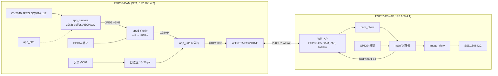
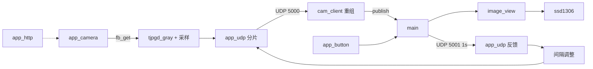
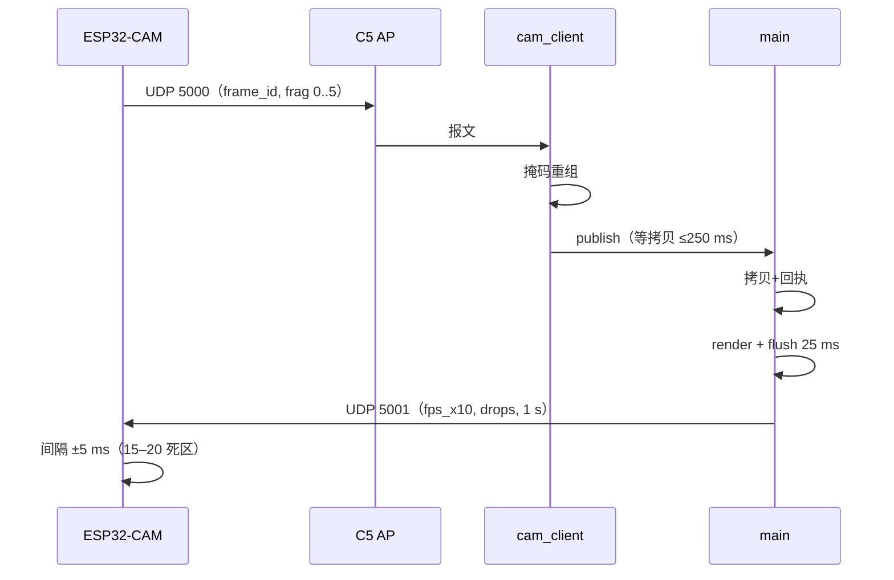

# 双芯无线取景器（DualLuma VF）技术文档

**副标题：ESP32-CAM → ESP32-C5 → SSD1306 无线图传链路**

| 文档信息 | 内容 |
|---|---|
| 项目名 | 双芯无线取景器（DualLuma VF） |
| 版本 | v1.0（评审稿） |
| 日期 | 2026-11 |
| 适用范围 | `esp32cam/`（ESP32）与 `esp32_oled/`（ESP32-C5）两个 ESP-IDF 6.1 工程，以及两者之间的 UDP 图传协议 |
| 读者 | 架构评审人、固件工程师、测试/调优工程师 |
| 约定 | **【待核对】**：有实现或声明，但需对照代码/硬件确认；**【待补充】**：材料缺失，需补测或补设计。两者不混用。 |

**修订历史**

| 版本 | 变更 |
|---|---|
| v0.1 | 初稿（系统概述、架构、模块、调优记录） |
| v0.2 | 合并稿（增加实现规格、实验记录、踩坑闭环） |
| v1.0 | 评审修订：项目命名、新增背景技术与器件边界、统一帧率口径、补全接口原型/生命周期/优先级理由、清理流程元信息 |

---

# 1. 项目背景与技术背景

## 1.1 项目背景与动机

**直接动机**：把 ESP32-CAM 的画面无线投到一块 128×64 OLED 上，做一个低成本、低延迟的取景器；相机端与显示端分离，显示端只负责接收与呈现。

**适用场景**（按本会话材料归纳）：

- 相机安装在不易靠近的位置（云台、管道、设备内部），需要一块远程取景屏；
- 相机本身没有翻转屏/取景屏，或成品无线图传成本过高；
- 教学/原型：用两块常见开发板演示"采集—编码—无线—显示"的完整链路。

**痛点**：

- 有线取景受线缆长度与走向限制；
- 成品无线图传（Wi-Fi/图传模块）价格与功耗高；
- 直接用摄像头模块的 JPEG 流做预览，接收端解码 CPU 压力大、帧率低。

**目标与非目标**：

- 目标：设计目标 15–20 fps；当前实测 18.5–20.5 fps；验收 ≥18 fps；传输稳定（send errors=0、丢帧可控、断线自愈）；暗光自动补光；按键拍照冻结。
- 非目标：云端、录像、音频、OTA、生产配网、电池/外壳（后续可选）。

> 具体产品场景（巡检/教学/消费电子）尚需与需求方确认。【待补充】

## 1.2 技术背景与器件能力边界

| 器件/组件 | 关键能力 | 硬约束 | 对本架构的影响 |
|---|---|---|---|
| OV2640 | 硬件 JPEG、QQVGA/QVGA、YUV422 | YUV422 QQVGA 实测约 **13.5 fps**；JPEG QQVGA 可稳定 ≥20 fps | 主路径必须用 JPEG 源；raw 直采反而更慢 |
| ESP32（CAM） | 双核 240 MHz、PSRAM、ROM tjpgd | **无 H.264/H.265 硬件编码**；软件编码不可实时 | 不做视频编码；本地只做 JPEG→灰度 |
| ESP32-C5 | 2.4 GHz + 5 GHz、WiFi 6、AP 能力 | 无视频硬解码；2.4 GHz 才能被 ESP32 关联 | 只做 AP + UDP 接收 + 显示 |
| SSD1306 | 128×64 单色、I2C 400 kHz | 全刷 1 024 B 实测 **25–33 ms → ~30–33 fps 上限** | 显示是硬墙；编码再快也受它限制 |
| tjpgd R0.03 | 支持 `JD_FORMAT=2` 只解 Y、1/2/1/4/1/8 缩放 | 需自带一份源码/配置 | CAM 端灰度解码 11–12 ms |
| ESP-IDF 6.1 / lwIP | UDP socket、`esp_timer`、NVS | 无内置可靠 UDP | 自定义分片 + 反馈控速 |
| LiPo/TP4056（参考方案） | 便携供电 | 需升压/充电/电量检测 | 当前用 USB；便携化是后续项 |

## 1.3 带宽与延迟预算（推导）

**帧字节预算**：

- 面板灰度：128×64×1 B = **8 192 B/帧**；
- UDP 载荷：6 片（5×1400 + 1192）+ 6×16 B 头 = 8 288 B；
- IP/UDP 头：6×28 = 168 B → 8 456 B；
- 802.11 MAC/FCS/BA：约 272 B → 约 8.7 KB/帧。

**带宽**：

- 20 fps × 8.7 KB ≈ **1.4 Mbps**；
- 关联速率 802.11n 20 MHz 1SS MCS7 = **72.2 Mbps**；
- 占比约 **2%**；即使 MAC 效率只有 30%，也仅 6–7%。→ **空口不是瓶颈**。

**延迟预算**（实测均值，端到端调度未单独打点）：

| 段 | 时间 |
|---|---|
| CAM capture | 0–4 ms |
| CAM encode（tjpgd Y-only + 1/2 + 采样） | 11–12 ms |
| CAM send（6 片 + 1 ms 间距） | 11–12 ms |
| 空口（8.7 KB @72 Mbps） | ≈1 ms |
| C5 重组 + 拷贝 | <1 ms |
| C5 render | 5 ms |
| C5 flush | 25 ms |
| 合计（不含排队） | **≈55–60 ms** |

→ 结论：**编码与显示是瓶颈，空口不是**。这也解释了第 8 章的决策：raw 模式更慢、RTSP 无收益、局部刷新收益有限。

## 1.4 同类方案对比

| 方案 | 帧率（本硬件） | 延迟 | 成本/复杂度 | 结论 |
|---|---|---|---|---|
| HTTP 单帧 GET | 1.4–1.9 fps（实测） | 高（逐帧建连/窗口） | 低/低 | 仅调试 |
| MJPEG over TCP `/stream` | 1–3 fps（实测，偶发 1.2–1.4 s 停顿） | 高 | 低/低 | 不满足 15 fps |
| 自定义 UDP + 反馈 | **18.5–20.5 fps（实测）** | ≈55–60 ms（预算） | 中/中 | **采用** |
| RTSP + H.264 | 理论可行但本硬件无硬编/硬解 | 编码+解码+抖动缓冲更高 | 高/高 | 不采用 |
| RTSP + H.265 | 同上，软解更重 | 更高 | 更高 | 不采用 |
| 蓝牙图传 | 带宽远低于 1.4 Mbps 需求 | 高 | 低/中 | 不采用 |
| 彩色 OLED/SPI 屏 | 可更高刷新 | 低 | 高/中 | 超出本项目范围 |

> RTSP/H.264/蓝牙为**理论分析**，未在本硬件实测；结论依据器件能力边界（无硬件编解码、显示 I2C 上限）。

## 1.5 文档定位、读者与约定

- 评审人：第 3/4/9/10 章看设计、边界与风险；
- 编码者：第 7 章可独立实现；
- 调优者：第 8 章可复现瓶颈定位与优化过程。
- 术语约定见文首；接口速查见 11.2。

---

# 2. 系统概述

## 2.1 目标与范围

- **设计目标**：15–20 fps；**当前实测**：18.5–20.5 fps；**验收**：≥18 fps。
- 稳定性：5 分钟稳态 send errors≤1、drops=0、断线 ≤3 s 自愈。
- 功能：UDP 图传、自动补光、按键拍照冻结/长按恢复、默认隐藏 AP、CAM 网页旁路。
- 非目标：云端、录像、音频、OTA、生产配网、电池/外壳（后续）。

## 2.2 一句话架构摘要

> **CAM 端 OV2640 出 JPEG（QQVGA、q12），用 tjpgd 只解 Y 并 1/2 缩放为 80×60 灰度，裁成 128×64 后经 UDP 六分片发送；C5 端重组后直接 1bpp 抖动显示；C5 每秒回传显示帧率，CAM 据此在 15–20 fps 目标内自适应发送间隔。**

## 2.3 关键结论摘要

| # | 结论 | 依据 |
|---|---|---|
| 1 | 设计目标 15–20 fps；当前实测 18.5–20.5 fps；验收 ≥18 fps | 5 分钟串口日志 |
| 2 | 帧率演进：HTTP 1.4–1.9 → TCP 流 1–3 → 解耦+全刷 3.8–7.2 → UDP 12.4–12.7 → 自适应 16.4–16.9 → tjpgd 灰度 18.5–20.5 fps（详见 8.6） | 各阶段 5 s 日志 |
| 3 | 稳态 send errors=0、drops=0；偶发 1 次瞬时 ENOMEM 不影响画面 | CAM/C5 日志 |
| 4 | “大场景断连”根因是 JPEG 缓冲仅 160×120/5=3840 B，已改 32 KB | `app_camera.c`、`cam_hal.c` |
| 5 | tjpgd 灰度把 CAM encode 从 24 ms 降到 11–12 ms；显示 I2C 25 ms 是下一道硬墙 | `tjpgd_gray/`、实测 |
| 6 | 补光用 AEC+avg 兜底，阈值 600/250、驻留 3 s；实测遮镜头 on（avg 19）、移开 off（aec 168/avg 121） | CAM 5 分钟日志 |
| 7 | AP 默认隐藏 SSID；CAM 按 SSID 关联不受影响 | Kconfig、扫描 |
| 8 | 遗留：C5 按键 GPIO0 无事件（实际 BOOT 引脚【待补充】）；CAM GPIO0 是 XCLK，不能做按键 | 日志、引脚表 |

---

# 3. 系统架构

## 3.1 逻辑架构

| 层 | 节点 | 组成 | 职责 |
|---|---|---|---|
| 设备层 | CAM | OV2640（QQVGA JPEG q12、XCLK 20 MHz、PSRAM）、GPIO4 补光灯 | 成像/补光 |
| 设备层 | C5 | SSD1306 128×64（I2C 0x3C、400 kHz、SDA=GPIO8/SCL=GPIO9）、GPIO0 按键 | 显示/交互 |
| 驱动层 | 两端 | `esp32-camera`、`esp_driver_i2c/gpio`、`esp_wifi/esp_netif/esp_event`、`esp_timer`、lwIP | 硬件与协议栈 |
| 服务层 | CAM | `app_camera`、`tjpgd_gray`、`app_udp`、`app_http`、`app_wifi`、`cam_selftest` | 采集、灰度编码、UDP、补光、旁路、接入 |
| 服务层 | C5 | `app_wifi_ap`、`cam_client`、`image_view`、`ssd1306`、`font5x7`、`app_button` | 热点、重组、渲染、刷屏、按键 |
| 应用层 | 两端 | `main.c` | 启动编排、显示状态机、统计 |

## 3.2 部署架构



| 项 | 现状 |
|---|---|
| AP | SSID `ESP32-C5-CAM`，密码 `c5cam12345`，ch6（1–13 可配），2.4 GHz，默认隐藏 |
| CAM 地址 | DHCP 首租约（通常 `192.168.4.2`） |
| 端口 | 数据 UDP 5000；反馈 UDP 5001（数据+1） |
| 旁路 | CAM HTTP：`/`、`/stream`、`/jpg`、`/raw`、`/mode`、`/status` |
| 固件 | C5 16 MB/3 MB factory，app 约 1.06 MB；CAM 4 MB/3 MB factory，app 约 0.87 MB（`idf.py size`） |
| 工具链 | ESP-IDF 6.1；C5 COM8、CAM COM5 |

## 3.3 数据架构

**数据帧（CAM→C5）**

| 字段 | 长度 | 说明 |
|---|---|---|
| magic | 2 B | `0x4341` |
| frame_id | 2 B | 每帧 +1，16 位回绕 |
| width/height | 2 B×2 | 128×64 |
| format | 1 B | 0=gray8（当前），1=jpeg（兼容） |
| frag_index/count | 1 B×2 | 0 起，≤64 |
| reserved | 1 B | 预留【待核对】 |
| payload_len | 4 B | 本片字节 |
| payload | ≤1400 B | 灰度 |

**反馈（C5→CAM）**：8 B，magic `0x4342`，`fps_x10`、`drops`、`reserved`。

**存储**：无数据库；仅 NVS（WiFi 校准/PHY）。帧数据全在 RAM/PSRAM。

## 3.4 技术栈与选型

| 组件 | 选型 | 理由 |
|---|---|---|
| SoC | ESP32 / ESP32-C5 | 现成模组；C5 可做 2.4 GHz AP |
| 摄像头 | OV2640 + `esp32-camera` | 硬件 JPEG，成熟驱动 |
| 解码 | CAM `tjpgd_gray`（Y-only）；C5 `esp_jpeg` 仅兜底 | 灰度只解 Y：encode 22–24 → **11–12 ms**（E13） |
| 传输 | 自定义 UDP | 无握手/重传，低延迟；反馈控速 |
| 显示 | SSD1306 + 自研驱动 | 128×64、I2C、引脚已验证 |
| 配置 | 两端 Kconfig | 编译期裁剪、可 diff |

## 3.5 边界与依赖

- 依赖：2.4 GHz 空口、OV2640/镜头、SSD1306/I2C、USB 供电。
- 不依赖：公网、时间同步、DNS、云端。
- 约束：CAM 仅 2.4 GHz；AP 必须 2.4 GHz；CAM GPIO0 被 XCLK 占用。

---

# 4. 框架设计

## 4.1 设计原则

1. 编码下沉：CAM 完成 JPEG 解码/灰度/裁剪/缩放，C5 零解码。
2. 单向数据 + 反向控制：图像 CAM→C5；仅 8 B 反馈回传。
3. 无服务器：上电即用。
4. 失败可重连：CAM STA 1 s 定时器；C5 自愈。
5. 配置即代码：全部 Kconfig。
6. 可观测：两端 5 s 汇总。

## 4.2 分层与依赖

```
应用层 main.c
   ↓
服务层 (app_camera/app_udp/app_wifi/app_http | app_wifi_ap/cam_client/image_view/app_button)
   ↓
驱动层 (esp32-camera/i2c_master/gpio/lwip/esp_wifi)
```

- 服务层只经明确接口协作；C5 显示任务只调 `cam_client_wait_frame()`；禁止跨层。
- 模块间契约见第 7 章。

## 4.3 设计模式

| 模式 | 位置 | 说明 |
|---|---|---|
| 生产者-消费者邮箱 | C5 `cam_client.c` | 最新帧发布，显示拷贝后回执 |
| 借用-回执 | C5 `cam_client.c` | 复用缓冲，拷贝完成才覆盖；最多等 250 ms |
| 编译期策略 | 两端 Kconfig | 尺寸/源/端口/间隔/按键/亮度/补光 |
| 状态机 | CAM 相机、C5 显示 | JPEG↔RAW；BOOT/WAIT/VIDEO/PHOTO/LOST |
| 反馈控制 | `app_udp.c`+`cam_client.c` | 1 s、±5 ms、15–20 fps 死区 |
| 协议 packed struct | 两端 | 小端线格式 |

## 4.4 横切关注点

| 关注点 | 现状 |
|---|---|
| 日志 | CAM 5 s：frames/fps/errors/interval/capture/encode/send/jpeg/flash/aec/gain/avg/rssi；C5 5 s：fps/fetch/render/flush/timeouts/errors/rssi/heap |
| 监控 | 无外部监控，串口即观测面 |
| 配置 | Kconfig；改后必须 `reconfigure` |
| 鉴权 | 仅 WPA2；UDP 报文无鉴权/加密 |
| 异常 | `esp_err_t`；socket 重试/计数；显示失败计数；解码失败丢帧 |
| 限流 | CAM 发送间隔 0–120 ms 自适应 |
| 灰度/回滚 | 固件重刷；无 A/B【待补充】 |
| 看门狗 | 未显式配置【待补充】 |

## 4.5 扩展点

- CAM：`APP_JPEG_SIZE`、`APP_UDP_SOURCE`、`APP_UDP_*`、`APP_FLASH_*`、`APP_WIFI_*`。
- C5：`APP_AP_*`、`APP_UDP_PORT`、`APP_BUTTON_*`、`APP_VIEW_*`。
- 无运行时插件。

## 4.6 通信/测试框架

- 通信：UDP 5000/5001；CAM HTTP 旁路。
- 数据访问：无数据库；NVS 由 WiFi 使用。
- 测试：无自动化测试；串口+人工+临时 ASCII 预览（已移除）。【待补充：CI】

## 4.7 优缺点

| 优点 | 风险 |
|---|---|
| 低延迟、C5 零解码、20 fps 稳定 | UDP 无 ACK，丢片丢帧 |
| 自适应控速避免堆积 | 反馈丢失后间隔冻结 |
| 配置集中、可裁剪 | 无鉴权/OTA；固定 IP/端口 |
| 编码下沉降低接收端负载 | CAM CPU/补光/传感器耦合 |

---

# 5. 模块设计

## 5.1 CAM

### 5.1.1 `app_camera`

- **职责**：OV2640 初始化/模式切换；JPEG/RAW 配置；帧获取/归还；AEC/AGC/AWB 使能；自检。
- **接口**：`app_cam_init()`、`app_cam_fb_get()/return()`、`app_cam_set_mode()`、`app_cam_luma_from_fb()`、`app_cam_frame_width/height/format()`。
- **数据**：JPEG QQVGA q12、`jpeg_buffer_size=32 KB`、`fb_count=3`、PSRAM；RAW YUV422 QQVGA、`fb_count=2`。
- **并发/异常**：模式切换锁 + 流用户计数；初始化失败重试 2 次并置不可用。
- **取舍**：32 KB 缓冲换复杂场景不截断；RAW 仅旁路。

### 5.1.2 `tjpgd_gray` 组件

- **职责**：只解 JPEG 的 Y 分量，输出 8 位灰度，支持 1/2/1/4/1/8 缩放。
- **接口**：`tjpgd_gray_decode()`（完整原型见 7.2）。
- **配置**：`JD_SZBUF=512`、`JD_FORMAT=2`、`JD_USE_SCALE=1`、`JD_TBLCLIP=1`、`JD_FASTDECODE=1`、`JD_DEFAULT_HUFFMAN=0`；符号重命名避免 ROM 冲突。
- **资源**：静态 workbuf 4096 B；QQVGA 1/2 → 80×60。
- **取舍**：自带 tjpgd 源码，需维护许可声明。

### 5.1.3 `app_udp`

- **职责**：取帧 → tjpgd 灰度 → 128×64 采样 → 6 分片 UDP；反馈调间隔；自动补光。
- **实现**：`SO_SNDBUF=16 KB`、分片间 1 ms、失败重试 3 次；控速初值 10 ms，`fps<18` −5、`fps>20` +5、`drops>2` +5，限幅 0–120 ms（与 15–20 目标一致）；补光见 7.4.4。
- **日志**：5 s 汇总（见 4.4）。
- **取舍**：灰度只解 Y，画质略软；可改 scale=0 换清晰度。

### 5.1.4 `app_wifi`

- **职责**：STA 加入 C5 AP；`WIFI_PS_NONE`；断线 1 s 定时器无限重连；20 s 未获 IP 进 APSTA 兜底。
- **接口**：`app_wifi_start()`、`app_wifi_url()`。
- **取舍**：无限重试牺牲独立可用，保 C5 复位后恢复。

### 5.1.5 `app_http`（旁路）

- 端点：`/`、`/stream`、`/jpg`、`/raw`、`/mode`、`/status`。
- 与 UDP 共占相机；有流用户时切换模式返回 409。

### 5.1.6 `main`/`cam_selftest`

- 启动：板卡信息、复位原因、NVS、相机、WiFi、HTTP、UDP；传感器缺失时自检。

## 5.2 C5

### 5.2.1 `app_wifi_ap`

- **职责**：SoftAP（2.4 GHz、ch6、WPA2、max 4、默认隐藏）、站点计数/RSSI。
- **接口**：`app_wifi_ap_start()`、`app_wifi_ap_ip()`、`app_wifi_ap_sta_count()`、`app_wifi_ap_sta_rssi()`。
- **已知**：`set_bandwidths(WIFI_BW20)` 首次生效；重关联后曾 40D【待核对】。

### 5.2.2 `cam_client`

- **职责**：绑定 5000；frame_id+64 位掩码重组；JPEG 兜底解码；发布最新帧；1 s 反馈。
- **接口**：`cam_client_start()`、`cam_client_wait_frame()`。
- **数据**：重组 24 KB、接收 2 KB、`SO_RCVBUF=32 KB`；邮箱=锁+两个二元信号量。
- **异常**：不完整帧在新 frag 0 丢弃并计 drops；非法包计数；显示 250 ms 未拷贝则接收方继续；JPEG 失败丢帧。
- **取舍**：无 ACK，靠反馈；掩码去重。

### 5.2.3 `image_view`

- **职责**：灰度帧→1bpp；2:1 中心裁剪、最近邻、增益、FS 抖动。
- **接口**：`image_view_render(disp, gray, w, h)`。
- **配置**：`APP_VIEW_GAIN=110`、`APP_VIEW_DITHER=y`。
- **取舍**：128×64 输入 1:1；抖动换灰阶。

### 5.2.4 `ssd1306`/`font5x7`

- **职责**：I2C 初始化、显存、像素/矩形/文本、全刷。
- **接口**：`ssd1306_init/flush/clear/pixel/fill_rect/text`。
- **指标**：全刷 1 024 B @400 kHz 实测 25–33 ms。
- **取舍**：全刷自愈；局部刷新已撤销。

### 5.2.5 `main`

- **职责**：NVS、OLED 探测（SDA/SCL 交换兜底）、AP、启动/等待/丢失屏、显示循环、按键拍照、5 s 统计。
- **交互**：短按冻结；冻结中按住 ≥500 ms 恢复；`photo_mode` 不消费帧。
- **状态**：`have_frame`、`lost_shown`、`photo_mode`、`consecutive_timeouts`。

### 5.2.6 `app_button`

- **职责**：GPIO0 输入（上拉、低有效、30 ms 去抖、10 ms 轮询）；短按（<500 ms）与长按（≥500 ms，按住即触发）。
- **接口**：`app_button_start()`、`app_button_take_short()`、`app_button_take_long()`。
- **配置**：`APP_BUTTON_GPIO=0`、`APP_BUTTON_ACTIVE_LOW=y`。
- **现状**：任务启动正常，但 5 分钟无按键事件；实际 BOOT 引脚【待补充】。

---

# 6. 模块功能分组

| 功能域 | 模块/子模块 | 核心功能 | 输入 | 输出 | 关键依赖 | 关键接口 | 备注 |
|---|---|---|---|---|---|---|---|
| 采集与编码 | `app_camera` | 传感器、模式、AEC/AGC、32 KB 缓冲 | 光 | JPEG | esp32-camera/PSRAM | `app_cam_fb_get()` | QQVGA q12 |
| 采集与编码 | `tjpgd_gray` | JPEG→Y 灰度、1/2 | JPEG | 80×60 | tjpgd | `tjpgd_gray_decode()` | 只解 Y |
| 采集与编码 | `app_udp`（编码） | 灰度→128×64 | 80×60 | 8 192 B | — | 内部采样 | 2:1 裁剪 |
| 传输 | `app_udp`（发送） | 6 分片、重试、1 ms | 面板帧 | UDP/5000 | lwIP | `sendto()` | 16 B 头 |
| 控制 | `app_udp`（反馈） | fps/drops→间隔 | 反馈 | 间隔 | lwIP | UDP/5001 | 15–20 fps |
| 补光 | `app_udp`（闪光） | AEC+avg 回差/驻留 | 亮度 | GPIO4 | GPIO | — | 600/250 |
| 接入 | `app_wifi`（CAM） | STA/重连/APSTA | 配置 | 网络 | esp_wifi | `app_wifi_start()` | PS=NONE |
| 接入 | `app_wifi_ap`（C5） | SoftAP/站点 | 配置 | 热点 | esp_wifi | `app_wifi_ap_start()` | 默认隐藏 |
| 呈现 | `cam_client` | 重组/邮箱/反馈/JPEG 兜底 | UDP | `cam_frame_t` | lwIP/esp_jpeg | `cam_client_wait_frame()` | 24 KB |
| 呈现 | `image_view` | 裁剪/缩放/增益/抖动 | 灰度 | 1bpp | ssd1306 | `image_view_render()` | FS |
| 呈现 | `ssd1306`/`font5x7` | 刷屏/文本 | 显存 | I2C | i2c_master | `ssd1306_flush()` | 25–33 ms |
| 交互 | `app_button`（C5） | 短按冻结/长按恢复 | GPIO0 | 事件 | GPIO | `app_button_take_*` | 引脚待确认 |
| 诊断 | `main`（两端） | 启动/状态屏/统计 | 配置/帧 | 日志/屏 | 上述 | — | 5 s |
| 旁路 | `app_http` | 网页/截图/模式 | HTTP | 网页/图 | esp_http_server | `/status` | 共占相机 |
| 自检 | `cam_selftest` | 传感器诊断 | — | 日志 | esp32-camera | — | 启动失败 |

---

# 7. 实现规格

## 7.1 协议与数据结构

### 7.1.1 数据报文（UDP 5000）

```c
typedef struct __attribute__((packed)) {
    uint16_t magic;        // 0x4341
    uint16_t frame_id;     // +1, wraps at 65535
    uint16_t width;        // 128
    uint16_t height;       // 64
    uint8_t  format;       // 0=gray8, 1=jpeg
    uint8_t  frag_index;   // 0..frag_count-1
    uint8_t  frag_count;   // 1..64
    uint8_t  reserved;     // reserved
    uint32_t payload_len;  // bytes in this fragment
} cam_udp_header_t;        // 16 B
```

- 小端；载荷 ≤1400 B；每帧 8192 B → 6 片；最大帧 24 KB。
- `frame_id` 回绕规则：frag 0 或 id 变化即重置重组；不做大小比较。
- 去重：64 位掩码，同片只计一次。
- `reserved` 未使用【待核对】。

### 7.1.2 反馈（UDP 5001）

```c
typedef struct __attribute__((packed)) {
    uint16_t magic;     // 0x4342
    uint16_t fps_x10;   // displayed fps * 10
    uint16_t drops;     // incomplete frames in this window
    uint16_t reserved;  // 0
} cam_feedback_t;       // 8 B
```

### 7.1.3 帧视图（C5）

```c
typedef struct {
    const uint8_t *data;   // 8-bit grey
    size_t len;
    uint16_t width;
    uint16_t height;
    bool from_jpeg;        // true only when the local JPEG fallback decoded it
} cam_frame_t;
```

`data` 指向 `cam_client` 内部缓冲或调用方提供的 `dst`；有效期为下一次 `wait_frame` 前。

## 7.2 接口契约

| 接口 | 完整原型 | 上下文 | 线程安全 | 阻塞/超时 | 所有权 | 错误码 |
|---|---|---|---|---|---|---|
| `tjpgd_gray_decode` | `esp_err_t tjpgd_gray_decode(const uint8_t *jpeg, size_t len, uint8_t *out, size_t out_cap, int scale, int *width, int *height)` | CAM UDP 任务 | 否（静态池） | 否 | 输出归调用方 | `ESP_ERR_INVALID_ARG/INVALID_SIZE/FAIL` |
| `app_udp_start` | `esp_err_t app_udp_start(void)` | CAM main | 单次 | 否 | 创建任务 | `ESP_ERR_NO_MEM` |
| `app_cam_fb_get` | `camera_fb_t *app_cam_fb_get(void)` | CAM UDP/HTTP | 驱动同步 | 可能等帧 | 调用方 `app_cam_fb_return` | NULL |
| `cam_client_start` | `esp_err_t cam_client_start(void)` | C5 main | 单次 | 否 | 创建任务/缓冲 | `ESP_ERR_NO_MEM` |
| `cam_client_wait_frame` | `esp_err_t cam_client_wait_frame(cam_frame_t *frame, uint8_t *dst, size_t dst_cap, uint32_t timeout_ms)` | C5 显示 | 是 | 超时 `timeout_ms` | 拷贝到 `dst` | `ESP_ERR_TIMEOUT/INVALID_SIZE/INVALID_STATE` |
| `app_button_take_short` | `bool app_button_take_short(void)` | C5 main | 是（volatile） | 否 | 消费事件 | — |
| `app_button_take_long` | `bool app_button_take_long(void)` | C5 main | 是 | 否 | 消费事件 | — |
| `ssd1306_flush` | `esp_err_t ssd1306_flush(ssd1306_t *dev)` | C5 显示 | 否 | I2C 200 ms/次 | — | I2C 错误 |
| `app_wifi_ap_sta_rssi` | `int app_wifi_ap_sta_rssi(void)` | C5 main | 是 | 否 | — | −127=无站点 |

## 7.3 并发模型

| 节点 | 任务 | 优先级 | 栈 | 触发 | 阻塞点 |
|---|---|---|---|---|---|
| CAM | main | 1 | 6144 | 启动 | 退出 |
| CAM | `cam_udp` | 5 | 6144 | 启动 | `fb_get`/`sendto`/`vTaskDelay` |
| CAM | `cam_fb`（反馈） | 4 | 3072 | 启动 | `recvfrom` |
| CAM | `mjpeg`（HTTP） | 5 | 4096 | 浏览器 | `send`/`fb_get` |
| C5 | main | 1 | 8192 | 启动 | `wait_frame`/I2C |
| C5 | `cam_udp` | 6 | 8192 | `cam_client_start` | `recvfrom`/`publish` |
| C5 | `button` | 4 | 3072 | `app_button_start` | `vTaskDelay(10 ms)` |

**优先级理由**：

- CAM `cam_udp`（5）> `cam_fb`（4）：图像是数据面，反馈是控制面；反馈延迟 1 s 级可接受，发送不能被反馈阻塞。
- C5 `cam_udp`（6）> main（1）：接收任务必须及时排空 socket，避免 UDP 丢包；显示在主任务中慢速运行即可。
- 按键（4）> main（1）：10 ms 轮询需要及时抢占显示循环。

同步对象与锁顺序：

| 对象 | 类型 | 规则 |
|---|---|---|
| `s_frame_ready` | 二元信号量 | 接收发布后 give；显示 take（500 ms） |
| `s_frame_taken` | 二元信号量 | 显示拷贝后 give；接收方最多等 250 ms |
| `s_pub_lock` | 互斥锁 | 保护 `s_pub/s_pub_valid`；内部不做阻塞/不取其他锁 |
| `s_short/s_long` | volatile bool | 单写（按键）/单读（main） |
| `s_interval_ms` | volatile int | 单写（反馈）/单读（发送） |

## 7.4 算法规格

### 7.4.1 JPEG 灰度（CAM）

```c
// JD_FORMAT=2, JD_USE_SCALE=1, pool=4096
jd_prepare(&jd, in_cb, pool, sizeof(pool), &ctx);
out_w = jd.width >> scale;   // scale=1 → 80
out_h = jd.height >> scale;  //           60
jd_decomp(&jd, out_cb, scale);
// out_cb: 逐行 memcpy，行宽 = rect->right - rect->left + 1
```

### 7.4.2 面板采样（128×64）

```c
if (w*64 > h*128) { crop_w = (h*128+32)/64; x0=(w-crop_w)/2; }
else              { crop_h = (w*64+64)/128; y0=(h-crop_h)/2; }
for y in 0..63: sy = y0 + y*crop_h/64;
  for x in 0..127: sx = x0 + x*crop_w/128;
    panel[y*128+x] = gray[sy*w+sx];
```

### 7.4.3 亮度与抖动（C5）

```c
v = gray[sx] * CONFIG_APP_VIEW_GAIN / 100;   // 110%
v += err_row[x]/16;
on = v >= 128;
e = v - (on?255:0);
err_row[x+1]+=e*7/16; err_next[x-1]+=e*3/16;
err_next[x]+=e*5/16;  err_next[x+1]+=e*1/16;
```

### 7.4.4 补光（CAM）

```c
avg = sum(panel)/8192;
if (frames%10==0) { sensor->init_status(sensor); aec=status.aec_value; gain=status.agc_gain; }
dark   = (aec > 600) || (avg < 20);
bright = (aec < 250) && (avg > 60);
if (!flash_on && dark   && now-changed > 3s) flash_on=true,  GPIO4=1;
if ( flash_on && bright && now-changed > 3s) flash_on=false, GPIO4=0;
```

## 7.5 状态机

### 7.5.1 重组（C5）

| 状态 | 事件 | 条件 | 动作 | 下一状态 |
|---|---|---|---|---|
| IDLE | frag 0 | magic 合法 | 重置 mask/长度/记录 id | ACTIVE |
| ACTIVE | frag i | 未收 | 拷贝+置位 | ACTIVE |
| ACTIVE | 新 id/frag 0 | 未收齐 | drops++，重置 | ACTIVE |
| ACTIVE | 收齐 | received==count | 发布 | IDLE |
| IDLE | 非法包 | — | drops++ | IDLE |

### 7.5.2 显示（C5）

| 状态 | 事件 | 条件 | 动作 | 下一状态 |
|---|---|---|---|---|
| BOOT | 启动完成 | AP 就绪 | 启动屏 | WAIT |
| WAIT | 首帧 | wait 成功 | 渲染 | VIDEO |
| VIDEO | 短按 | !photo | 冻结 | PHOTO |
| VIDEO | 连续 3 超时 | — | LOST 屏 | LOST |
| PHOTO | 长按 | ≥500 ms | 恢复 | VIDEO |
| LOST | 帧恢复 | wait 成功 | 渲染 | VIDEO |

### 7.5.3 相机模式（CAM）

| 状态 | 事件 | 条件 | 动作 | 下一状态 |
|---|---|---|---|---|
| JPEG | set RAW | 无流用户 | deinit/init YUV422 | RAW |
| RAW | set JPEG | 无流用户 | deinit/init JPEG | JPEG |
| 任意 | 同模式 | — | `ESP_ERR_NOT_FINISHED` | 不变 |

## 7.6 内存预算

| 节点 | 缓冲 | 大小 | 位置 | 生命周期 |
|---|---|---|---|---|
| CAM | JPEG fb ×3 | 3×32 KB + DMA | PSRAM | 初始化后常驻 |
| CAM | `s_gray` | 19 200 B | PSRAM | 首次解码分配，常驻（不释放） |
| CAM | `s_panel` | 8 192 B | BSS | 常驻 |
| CAM | UDP packet | 1 416 B | 任务栈 | 每帧复用 |
| CAM | tjpgd pool | 4 096 B | BSS | 常驻 |
| C5 | `s_asm` | 24 KB | heap | 启动分配，常驻 |
| C5 | `s_rx` | 2 KB | heap | 启动分配，常驻 |
| C5 | `frame_buf` | 32 KB | heap | 启动分配，常驻 |
| C5 | SSD1306 fb | 1 024 B | heap | 常驻 |
| C5 | JPEG 兜底 `s_rgb`/`s_gray_buf` | ~38.4 KB / 19.2 KB | heap | 仅收到 `format=1` 时按需分配；分配后**常驻复用，不在帧间释放**（灰度模式下不分配） |
| C5 | 稳态剩余堆 | ~120.8 KB | — | 实测 |

## 7.7 配置映射

| 配置 | 宏 | 使用点 | 默认 |
|---|---|---|---|
| CAM `APP_JPEG_SIZE` | `CONFIG_APP_JPEG_QQVGA` | `app_camera.c` | QQVGA |
| CAM `APP_UDP_SOURCE` | `CONFIG_APP_UDP_SOURCE_JPEG` | `app_udp_start` | JPEG |
| CAM `APP_UDP_HOST/PORT` | 同名 | `udp_task` | 192.168.4.1:5000 |
| CAM `APP_UDP_ADAPT` | 同名 | 反馈任务 | y |
| CAM `APP_UDP_INTERVAL_MS` | 同名 | 间隔初值 | 10 |
| CAM `APP_FLASH_*` | 同名 | `update_flash` | 600/250/3000 |
| CAM `APP_WIFI_*` | 同名 | `app_wifi.c` | SSID/c5cam12345 |
| C5 `APP_AP_*` | 同名 | `app_wifi_ap.c` | 隐藏、ch6 |
| C5 `APP_UDP_PORT` | 同名 | `cam_client.c` | 5000 |
| C5 `APP_BUTTON_*` | 同名 | `app_button.*` | GPIO0、低有效 |
| C5 `APP_VIEW_*` | 同名 | `image_view.c` | 110%、抖动 y |
| C5 `CONFIG_ESP_MAIN_TASK_STACK_SIZE` | 同名 | main | 8192 |

## 7.8 验收标准

| 条目 | 标准 |
|---|---|
| 帧率口径 | **设计目标 15–20 fps；当前实测 18.5–20.5 fps；验收 ≥18 fps** |
| CAM 单帧 | capture+encode+send ≤30 ms |
| C5 单帧 | render+flush ≤35 ms |
| send errors | 5 分钟 ≤1（瞬时 ENOMEM 可接受） |
| drops | 5 分钟 0 |
| 剩余堆 | ≥100 KB |
| 断线恢复 | C5 复位后 ≤3 s 重连、≤3 s 恢复画面 |
| 大场景 | JPEG max <32 KB 且无 `CAMERA LOST` |
| 补光 | 遮镜头 3–5 s 开灯；移开变亮 3 s 后关灯；无 3 s 周期乒乓 |
| 拍照 | 短按冻结、长按 500 ms 恢复【待补充：按键引脚确认】 |
| SSID | 默认扫描不可见；CAM 仍可关联 |

---

# 8. 调优与调试：帧率与传输稳定性优化

## 8.0 主线

目标：把端到端显示帧率提升到 15–20 fps，并保持传输稳定（send errors=0、丢帧可控、断线自愈）。本章按“指标—定位—实验—决策—主线—对比—踩坑—待办—方法论”组织。

## 8.1 指标体系

| 指标 | 定义 | 采集 | 周期 | 日志 | 阈值 |
|---|---|---|---|---|---|
| fps | 5 s 显示帧数/时间 | C5 `c5view` | 5 s | `N frames, X.X fps` | 18–21 正常；<15 低 |
| fetch | 等帧+拷贝 | C5 | 5 s 均值 | `fetch N ms` | ≤30；>80 异常 |
| render | 裁剪/缩放/抖动 | C5 | 5 s | `render N ms` | ≤6 |
| flush | I2C 全刷 | C5 | 5 s | `flush N ms` | 25–33（硬上限） |
| drops | 不完整/非法帧 | C5 `cam_udp` | 每帧+5 s | `drops N` | 0；>2 降速 |
| send errors | `sendto` 失败 | CAM | 5 s | `errors N` | 0；偶发 1 可接受 |
| capture | `fb_get` | CAM | 5 s | `capture N ms` | ≤5 |
| encode | 灰度解码+采样 | CAM | 5 s | `encode N ms` | 10–15 |
| send | 分片发送 | CAM | 5 s | `send N ms` | ≤15 |
| interval | 自适应间隔 | CAM | 变化/5 s | `interval N ms` | 收敛 20–30 |
| RSSI | 链路 | 两端 | 5 s | `rssi N dBm` | −30~−60 |
| AEC/gain/avg | 补光判据 | CAM | 5 s | `aec/gain/avg` | 遮镜头 avg<20 |
| heap | C5 剩余堆 | C5 | 5 s | `heap N` | ≥100 KB |

### 8.1.1 观测面缺口与补测计划

- 缺 CPU 占用率、端到端逐帧延迟、空口重传/速率计数、温度/电流；
- 计划：接入 `esp_timer` 端到端打点（相机帧时间→C5 显示完成）、`esp_wifi_statis_dump` 定期采样、ADC 电流/温度。【待补充】

## 8.2 瓶颈定位方法与证据链

1. CAM 分段：`fb_get`/解码/发送；C5 分段：wait/render/flush；
2. 5 s 汇总，同场景同窗口；
3. 排除法：capture 大→采集慢；send 大→发不出/反压；C5 fetch 大而 CAM send 小→收不齐；draw 大→画得慢；
4. 对照实验：单变量、同场景、同窗口。

真实链路：
- HTTP 单帧 1.4–1.9 fps，fetch 200–1500 ms；CAM 采集 0–40 ms、发送 26–67 ms；
- 排除采集/显示；C5 正文偶发 1.2–1.4 s，CAM 发送阻塞 700–1000 ms → TCP 窗口/重传/逐帧建连；
- 长连接仍 1–3 fps；改 UDP + 解耦 → 12 fps；再降字节/换解码 → 20 fps。

## 8.3 调优实验记录

| 编号 | 假设 | 唯一变更 | 改动 | 变更前 | 变更后 | 窗口 | 结论 | 保留 | 回滚 |
|---|---|---|---|---|---|---|---|---|---|
| E01 | 逐帧建连是主因 | 传输 | `/raw` GET → `/stream` | 1.4–1.9 fps，fetch 200–1500 | 1–3 fps，body 偶发 1.2–1.4 s | 5 s×6 | 仍受 TCP 影响 | 否 | 回单帧 |
| E02 | TCP 反压是主因 | 传输模型 | UDP+反馈 | 1–3 fps | 12.4–12.7 fps | 5 s×8 | 数量级提升 | 是 | 保留 HTTP |
| E03 | 画屏阻塞读 | 任务模型 | 接收独立任务+邮箱 | 单任务 30 ms 阻塞 | C5 12 fps、0 超时 | 5 s×6 | 消除反压 | 是 | 单任务 |
| E04 | 每帧字节多 | 编码位置 | C5 解码→CAM 解码 128×64 | 19.2 KB；8–12 fps | 8.2 KB；12.6 fps | 5 s×8 | 字节减半 | 是 | JPEG 分片 |
| E05 | JPEG 仍大 | 尺寸 | QVGA→QQVGA | 10–15 KB | 2.5–3.8 KB | 5 s×6 | 双降 | 是 | QVGA |
| E06 | 图像错位=字节序 | 算法 | RGB565 大端→小端 | 画面异常 | 正常 | 目视/ASCII | 根因确认 | 是 | 改回复现 |
| E07 | 局部刷新省 I2C | 刷新 | 只刷变化页 | draw 30–33 | 仍 ~30（抖动多页变化） | 5 s×4 | 收益有限/怕脏页 | 否 | 全刷 |
| E08 | modem sleep 增时延 | 省电 | `WIFI_PS_NONE` | fetch 抖动 100–300 | 抖动下降 | 5 s×4 | 降时延 | 是 | 默认 |
| E09 | HT40 干扰 | 带宽 | 20 MHz | 偶发丢帧 | 首次 CBW20；重关联曾 40D | 5 s×4 | 持久性待复现 | 部分 | 默认 |
| E10 | lwIP 缓冲不足 | socket | sndbuf 16 KB+1 ms+重试 3 | 1–2/s ENOMEM | errors 0 | 50 s | 消除丢帧 | 是 | 默认 |
| E11 | 固定间隔不适配 | 控速 | 反馈（1 s，±5 ms，15–20） | 12.7 fps | 16.4–16.9 fps | 50 s | 收敛 20–30 ms | 是 | 固定 |
| E12 | 全尺寸解码慢 | 缩放 | RGB565 全尺寸→1/2 | encode 37 ms | 22 ms | 5 s×6 | 上限 22→31 fps | 是 | 全尺寸 |
| E13 | 解码仍可省 | 格式 | esp_jpeg→tjpgd Y-only | encode 22–24 | **11–12 ms** | 5 s×8 | 上限 ~40 fps | 是 | 回 esp_jpeg |
| E14 | 补光判据失效 | 判据 | avg→AEC+avg 兜底 | 灯常亮/不亮 | 遮镜头 on(avg 19)，移开 off(aec168/avg121) | 5 min | 可开可关 | 是 | 改阈值 |
| E15 | 大场景断连 | 缓冲 | JPEG 3 840 B→32 KB | 复杂场景丢帧/LOST | 5 min 无断连 | 5 min | 根因修复 | 是 | 自动 |

## 8.4 架构级改造决策

| 决策 | 原瓶颈 | 动机 | 收益 | 代价/风险 | 结论 |
|---|---|---|---|---|---|
| TCP→UDP | 窗口/重传/建连 1–3 fps | 低延迟 | 12.4–12.7 fps | 无 ACK，丢片丢帧 | 采用 |
| 单任务→双任务 | 画屏阻塞 socket | 解耦 | 12 fps、0 超时 | 邮箱/锁 | 采用 |
| C5 解码→CAM 解码 | C5 堆紧/CPU | 编码下沉 | C5 零解码、8.2 KB | CAM 负载 | 采用 |
| 全尺寸→1/2 | encode 37 ms | 减解码量 | 22 ms | 画质略降 | 采用 |
| esp_jpeg→tjpgd Y | 色度/转换 | 只解所需 | 11–12 ms | 自带 tjpgd | 采用 |
| 局部→全刷 | 收益小/脏页 | 自愈 | draw 25–33 | 静态多耗总线 | 采用 |
| YUV422 raw | 无解码 | 最快 | encode 2 ms 但 capture 74 ms（~13.5 fps） | 帧率反降 | 不采用 |
| RTSP+H.264/265 | 码率/兼容 | 标准流 | 无硬编/硬解；I2C 30 fps 墙 | 复杂度/延迟 | 不采用 |

## 8.5 帧率与稳定性优化主线

### 8.5.1 阶段目标 vs 达成

| 阶段 | 目标 | 实际 | 关键改动 |
|---|---|---|---|
| S0 | 能显示 | 1.4–1.9 fps | HTTP 单帧 |
| S1 | >3 fps | 1–3 fps | `/stream` |
| S2 | >10 fps | 12.4–12.7 fps | UDP、双任务、CAM 解码 |
| S3 | 15–20 fps | 16.4–16.9 fps | 反馈控速 |
| S4 | 稳定 20 fps | 18.5–20.5 fps | tjpgd Y-only + 1/2 |

### 8.5.2 关键因子拆解

| 因子 | 证据 | 改善 | 贡献 |
|---|---|---|---|
| 采集出图 | capture 0–4（JPEG）/74 ms（raw） | 保持 JPEG 源 | 避免 13.5 fps 上限 |
| 编码位置 | C5 解码时堆 ~60 KB、8–12 fps | 移到 CAM | 释放 C5、降延迟 |
| JPEG 尺寸 | 10–15→2.5–3.8 KB | QQVGA | 解码/带宽下降 |
| 解码格式 | encode 22–24（RGB565） | tjpgd Y+1/2 | 11–12 ms |
| 每帧字节 | 19.2→8.2 KB | 128×64 灰度 | 空口/重组更轻 |
| 空口 | MCS7/20 MHz、RSSI −40~−50、20 fps≈1.3 Mbps | 信道/带宽/位置 | 非瓶颈（~2%） |
| 收发解耦 | 画屏 30 ms 时 CAM send 阻塞 | 双任务+邮箱 | 消除反压 |
| 显示刷新 | flush 25–33 ms | 全刷/抖动 | 上限 30–33 fps |
| socket/重试 | ENOMEM 1–2/s | sndbuf/间距/重试 | errors 0 |
| 发送节流 | 12.7 fps 固定 | 反馈 15–20 | 稳态 20 fps |
| 补光 | AEC 关闭/avg 中灰 | 开 AEC/AGC+avg 兜底 | 可开可关 |

### 8.5.3 自适应发送间隔

- 反馈：1 s `fps_x10/drops`；
- 规则：`drops>2` +5 ms；`fps<18` −5 ms；`fps>20` +5 ms；限幅 0–120 ms（与设计目标 15–20、验收 ≥18 对齐）；
- 收敛：20 ms + 11 ms encode → 20 fps；
- 边界：反馈丢失→间隔冻结（不自恢复）【风险】；空口恶化→drops 升→放慢；内存不足→解码失败/丢帧；
- 振荡：曾 ±10 ms + 14–18 死区导致 15–17 fps 抖动；改 ±5 ms + 18–21 → 稳定；当前按 15–20 目标取 18/20 阈值。

## 8.6 阶段效果对比

| 阶段 | C5 fps | CAM 关键耗时 | C5 关键耗时 | 帧字节 |
|---|---|---|---|---|
| HTTP 单帧 | 1.4–1.9 | capture 0–4/send 26–67 | fetch 200–1500 | 19.2 KB |
| HTTP 流 | 1–3 | send 700–1000（反压） | body 1.2–1.4 s | 19.2 KB |
| UDP+解耦 | 12.4–12.7 | capture 0/encode 37/send 8 | fetch 30–70/flush 30 | 8.2 KB |
| 自适应 | 16.4–16.9 | encode 22–24/send 9 | fetch 28–31/flush 25 | 8.2 KB |
| tjpgd 灰度 | **18.5–20.5** | encode 11–12/send 11 | fetch 21–24/flush 25 | 8.2 KB |

## 8.7 踩坑闭环

| 现象 | 根因 | 修复 | 验证 | 教训 |
|---|---|---|---|---|
| JPEG 画面不对 | RGB565 按大端读 | 改小端 | ASCII/目视 | 先核对解码器字节序 |
| Kconfig 不生效 | 未 reconfigure | reconfigure | sdkconfig 新项 | 变更必须 reconfigure |
| 偶发 ENOMEM | pbuf/发送缓冲瞬时不足 | sndbuf+间距+重试 | errors 0 | 突发分片要限速/重试 |
| 局部刷新脏页 | I2C 抖动后不重发 | 恢复全刷 | draw 25–33 | 显示优先自愈 |
| 大场景断连 | JPEG 自动 3 840 B 截断 | 32 KB buffer | 5 min 无 LOST | 查驱动默认分配 |
| 补光灯异常 | AEC/AGC 初始关闭 | 开 AEC/AGC+avg 兜底+回差/驻留 | 遮/移开 | 先确认自动曝光 |
| 按 CAM IO0 无反应 | GPIO0 是 XCLK | 用 C5 IO0 或 CAM 空闲脚 | `xclk ... GPIO0` | 先核对引脚复用 |
| 扫描看不到 AP | Windows 扫描缓存 | 重扫 | 第二次可见 | 扫描要复测 |
| HT20 重关联 40D | 带宽持久性 | 待复现 | 日志 | 【待核对】 |
| raw 更慢 | YUV422 QQVGA ~13.5 fps | 保持 JPEG | capture 74 ms | 理论最快≠实际 |
| RTSP 不可行 | 无硬编/硬解；I2C 墙 | 不采用 | 架构分析 | 先确认硬件能力 |

## 8.8 未实施优化

| 建议 | 预期收益 | 风险/成本 | 验证 | 优先级 |
|---|---|---|---|---|
| UDP NACK/FEC | 丢帧下降 | 带宽/复杂度 | 丢包注入 | 中 |
| 4bpp/RLE | 帧字节减半，25–30 fps | C5 解压/画质 | 同场景 | 中 |
| 局部刷新加固 | 静态省总线 | 稳定性 | 长稳+注入 | 低 |
| 信道自动扫描 | 抗干扰 | 启动 +1–2 s | 多信道 | 低 |
| 反馈超时自恢复 | 反馈丢失恢复 | 防过速 | 断反馈 | 中 |
| OTA/双分区 | 可运维 | 分区/回滚 | 升级测试 | 低 |
| CAM GPIO13 快门 | CAM 侧按键 | 控制协议 | 目视/日志 | 中 |
| 长稳/温升/距离 | 发现隐藏缺陷 | 测试环境 | ≥24 h | 高 |

## 8.9 方法论

1. 先定位瓶颈；2. 建指标；3. 单变量小步；4. 必要时换模型；5. 灰度验证+可回滚；6. 判断准则：调参收益 <10% 且瓶颈在模型/硬件时换架构；显示 I2C 是硬墙，调参无效。

---

# 9. 模块之间协同

> 接口/缓冲/协议的细节见第 7 章（7.2/7.6/7.1），本章只描述关系与时序。

## 9.1 协同总览



## 9.2 同步调用链

| 调用方 | 被调方 | 接口 | 超时/降级 |
|---|---|---|---|
| C5 main | `cam_client_wait_frame` | 见 7.2 | 500 ms；连续 3 次→LOST |
| C5 cam_udp | JPEG 兜底解码 | 见 7.2 | 失败丢帧 |
| CAM cam_udp | `app_cam_fb_get` | 见 7.2 | 100 ms 重试 |
| CAM cam_udp | `tjpgd_gray_decode` | 见 7.2 | 失败计数 |
| CAM cam_udp | `sendto` | — | 3 次重试→计数 |
| C5 main | `ssd1306_flush` | 见 7.2 | 失败计数 |

## 9.3 异步事件流



## 9.4 数据流与缓冲

见 7.6 的内存预算表；缓冲区所有权与生命周期以该表为准。

## 9.5 共享依赖

WiFi/NVS（两端）；CAM PSRAM；C5 堆；相机帧由 UDP 与 HTTP 旁路共享（弱隔离）。

## 9.6 关键时序

- 正常启动：C5 1.1 s AP → CAM 3.2 s 关联/DHCP → UDP → 首帧；
- C5 复位：CAM 1 s 定时重连；C5 3 次超时（1.5 s）LOST，恢复后出图；
- 丢片：该帧不完整→下一帧 frag 0 丢弃并计 drops。

## 9.7 故障传播与隔离

| 故障 | 传播 | 隔离/恢复 |
|---|---|---|
| CAM 掉线 | C5 超时 | CAM 定时重连 |
| C5 复位 | CAM 断开 | 1 s 重连 |
| 空口拥塞 | 丢包/丢帧 | 反馈降速；单帧丢弃 |
| 解码失败 | 单帧 | 计数继续 |
| I2C 失败 | 显示 | 全刷自愈 |
| 反馈丢失 | 间隔冻结 | 不自恢复【风险】 |
| 大 JPEG | 截断 | 32 KB 修复 |

## 9.8 契约与版本

packed 小端；magic 判别；C5 兼容 format 0/1；`reserved` 预留版本位【待核对】。

---

# 10. 风险、遗留问题与待补充

## 10.1 架构风险

- UDP 无 ACK/重传/鉴权；AP 单点；无 OTA；固定 IP/端口；HT20 持久性待复现；
- 显示 I2C 25–33 ms/帧是硬上限（~30–33 fps），任何编码优化无法突破。

## 10.2 模块耦合风险

- 相机双消费者（UDP/HTTP）互相降帧；反馈丢失后间隔冻结；邮箱 250 ms 超时；两端配置需人工一致。

## 10.3 协同链路风险

- 启动顺序：C5 先起最佳；CAM 先起 20 s 后 APSTA 兜底；
- 反馈端口硬编码为数据+1；`frame_id` 回绕极端情况可能短暂误重组。

## 10.4 调优待验证项

- 长稳（≥24 h）、温升、距离/遮挡；复杂场景 JPEG max 是否逼近 32 KB；
- 按键实际 BOOT 引脚；补光强光/全黑乒乓；局部刷新加固；功耗。

## 10.5 【待补充】清单

- **背景技术所需的需求确认**：目标场景（巡检/教学/消费）、成本/尺寸/功耗约束、是否便携；
- C5 板 BOOT 键确切 GPIO（当前 GPIO0 无事件）；
- CAM 板按键方案（GPIO13/14 + 远程快门协议）；
- 长稳/温升/距离/功耗测试报告；
- 自动化测试与 CI；
- OTA/双分区与回滚；
- 协议版本化与兼容矩阵；
- 安全评审（报文鉴权/防重放）；
- 硬件型号/原理图/天线位置/RSSI 分布；
- 生产烧录与校准；
- 局部刷新正式实现与验证。

---

# 11. 附录

## 11.1 术语表

| 术语 | 含义 |
|---|---|
| AP/STA | 接入点/站点 |
| Luma | 亮度 Y |
| 1bpp | 每像素 1 位 |
| FS 抖动 | Floyd–Steinberg 误差扩散 |
| 邮箱 | 生产者-消费者传递最新帧 |
| 分片 | 一帧拆多个 UDP 报文 |
| AEC/AGC | 自动曝光/自动增益 |
| ENOMEM | lwIP 缓冲不足 |

## 11.2 关键接口速查

见 7.2（完整原型/线程安全/超时/所有权/错误码）；协议见 7.1；配置见 7.7。

## 11.3 关键配置项

**C5**

| 配置 | 默认 | 说明 |
|---|---|---|
| `APP_AP_SSID` | ESP32-C5-CAM | 热点名 |
| `APP_AP_HIDDEN` | y | 隐藏 SSID |
| `APP_AP_PASSWORD` | c5cam12345 | WPA2 |
| `APP_AP_CHANNEL` | 6 | 2.4 GHz |
| `APP_UDP_PORT` | 5000 | 数据；反馈+1 |
| `APP_BUTTON_GPIO` | 0 | 按键 |
| `APP_BUTTON_ACTIVE_LOW` | y | 低有效 |
| `APP_VIEW_GAIN` | 110 | 亮度 % |
| `APP_VIEW_DITHER` | y | 抖动 |
| `CONFIG_ESP_MAIN_TASK_STACK_SIZE` | 8192 | 主任务栈 |

**CAM**

| 配置 | 默认 | 说明 |
|---|---|---|
| `APP_WIFI_MODE` | STA | 加入 C5 AP |
| `APP_WIFI_STA_SSID/PASSWORD` | ESP32-C5-CAM/c5cam12345 | 必须匹配 |
| `APP_WIFI_AP_SSID/PASSWORD` | ESP32-CAM/esp32cam123 | 兜底热点 |
| `APP_JPEG_SIZE` | QQVGA | 160×120 |
| `APP_UDP_SOURCE` | JPEG | 推荐 |
| `APP_UDP_HOST/PORT` | 192.168.4.1:5000 | 目标 |
| `APP_UDP_ADAPT` | y | 自适应 |
| `APP_UDP_INTERVAL_MS` | 10 | 初值 |
| `APP_FLASH_DARK_AEC` | 600 | 开灯 |
| `APP_FLASH_BRIGHT_AEC` | 250 | 关灯 |
| `APP_FLASH_DWELL_MS` | 3000 | 驻留 |

## 11.4 目录结构

```text
ESP322board/
├── esp32cam/
│   ├── main/ (main.c, app_camera.*, app_udp.*, app_http.*, app_wifi.*, cam_selftest.*, camera_pins.h, Kconfig.projbuild, CMakeLists.txt)
│   ├── components/tjpgd_gray/ (tjpgd.c/h, tjpgdcnf.h, tjpgd_gray.c/h)
│   ├── partitions.csv, sdkconfig, sdkconfig.defaults
├── esp32_oled/
│   ├── main/ (main.c, app_wifi_ap.*, cam_client.*, image_view.*, app_button.*, ssd1306.*, font5x7.*, Kconfig.projbuild, CMakeLists.txt)
│   ├── partitions.csv, sdkconfig, sdkconfig.defaults
└── docs/技术文档.md
```

## 11.5 构建与烧录

- ESP-IDF 6.1；`IDF_PATH=D:/esp/.espressif/v6.1/esp-idf`；`IDF_TOOLS_PATH=C:/Espressif/tools`。
- 构建：`idf.py build`；**改 Kconfig 后必须 `idf.py reconfigure`**。
- 烧录：C5 `idf.py -p COM8 flash`；CAM `idf.py -p COM5 flash`。
- 旧 `build/` 路径不符需删除重建；固件大小来源 `idf.py size`。
- 串口 115200；两端可同时抓取（pyserial，DTR/RTS 拉低）。

## 11.6 参考资料

- ESP-IDF 6.1（WiFi、lwIP、I2C、GPIO、esp_timer）。
- `espressif/esp_jpeg 1.3.2`（ROM 解码、RGB565 字节序）。
- TJpgDec R0.03（ChaN，`JD_FORMAT=2`、缩放）。
- `esp32-camera`（OV2640、帧缓冲、AEC）。
- SSD1306 数据手册。
- 本项目源码与历史实测日志。

---

**文档完整性**：第 1–11 章齐全；第 8 章为调优主线；关键结论均标注代码/日志依据；缺失项已标【待补充】/【待核对】。
